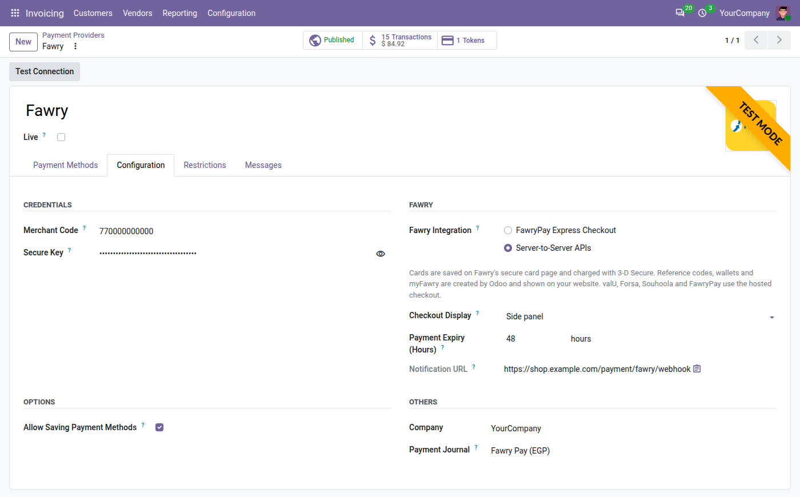
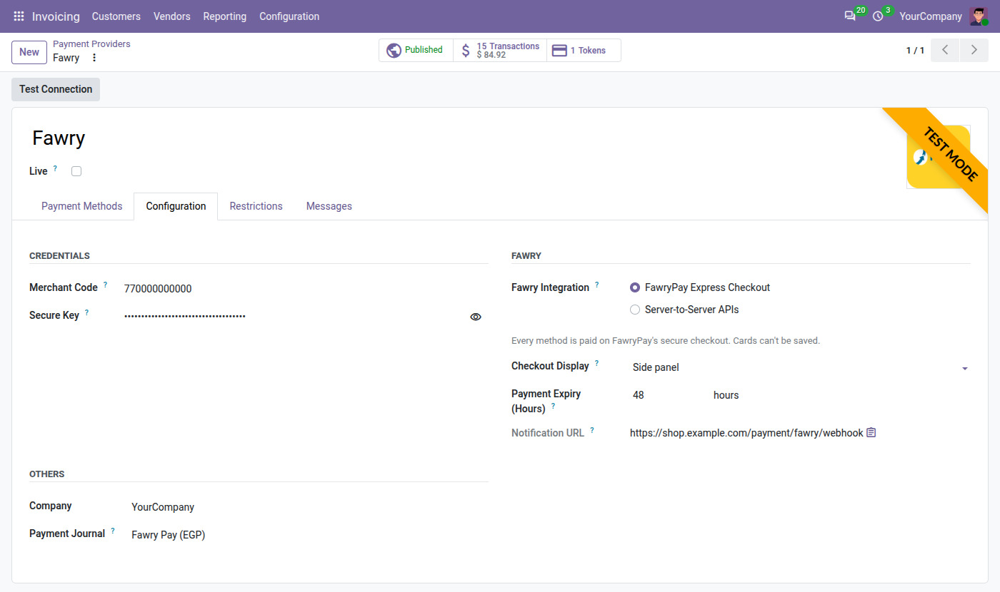
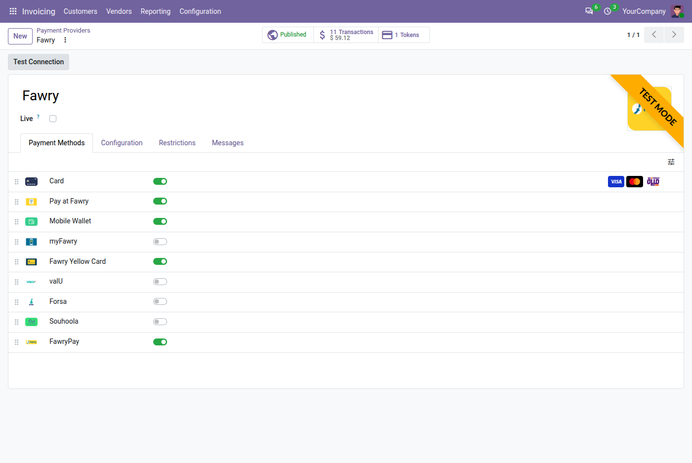
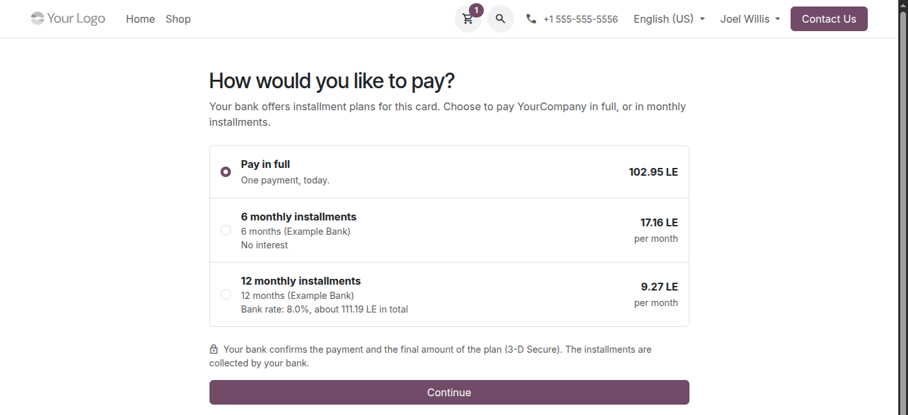
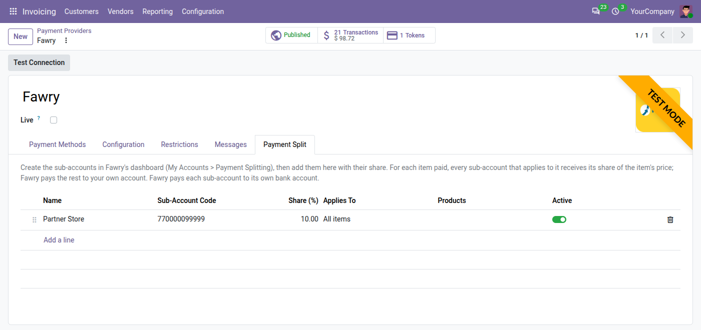
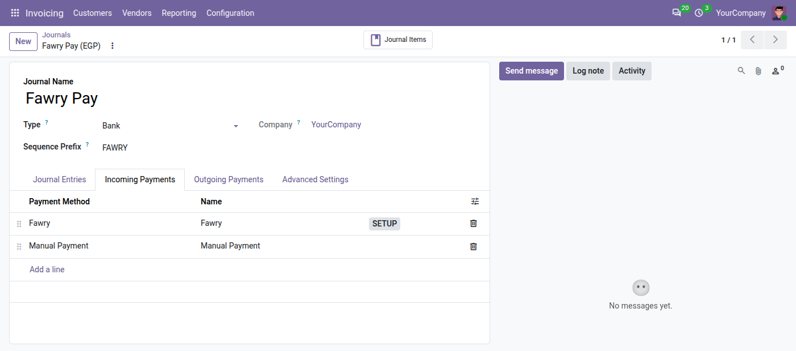
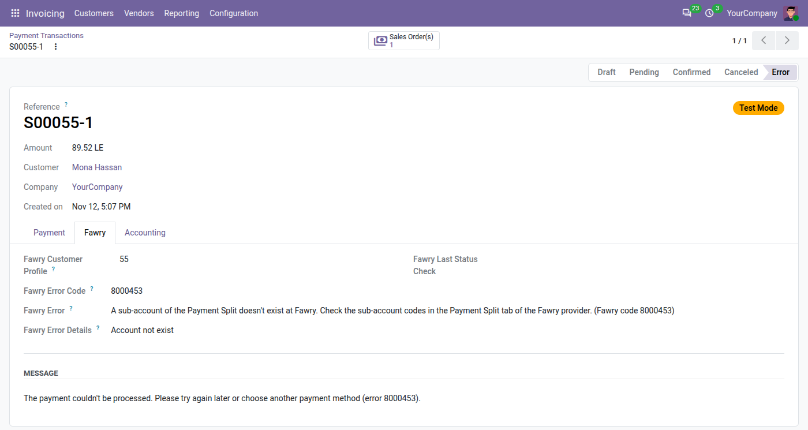

# Fawry Payments: administrator guide

How to set up and run the **Fawry Payments** module (`payment_fawry_cf`) on Odoo 20. For the daily tasks of
your team and what customers see, read the [user guide](user_guide.md).

## Contents

- [Before you start](#before-you-start)
- [1. Install the module](#1-install-the-module)
- [2. Enter your credentials](#2-enter-your-credentials)
- [3. Choose the integration and the display](#3-choose-the-integration-and-the-display)
- [4. Give the notification URL to Fawry](#4-give-the-notification-url-to-fawry)
- [5. Turn on your payment methods](#5-turn-on-your-payment-methods)
- [6. Check the payment journal](#6-check-the-payment-journal)
- [7. Test](#7-test)
- [8. Go live](#8-go-live)
- [Bank installments](#bank-installments)
- [Payment split](#payment-split)
- [Settings reference](#settings-reference)
- [Accounting](#accounting)
- [Payment statuses](#payment-statuses)
- [Fawry error codes](#fawry-error-codes)
- [Security](#security)
- [Troubleshooting](#troubleshooting)

## Before you start

- A Fawry merchant account. Fawry first gives a **test (staging)** merchant code and secure key, then the
  **live** ones. Ask Fawry which APIs your account has: FawryPay Express Checkout, the server-to-server APIs, or
  both.
- Your Odoo website reachable from the internet over **HTTPS**, so that Fawry can bring customers back and send
  its notifications.
- Prices in **Egyptian pounds (EGP)** on the website pricelist: Fawry accepts EGP only.
- The **Invoicing** app (installed with eCommerce) with a chart of accounts, for the Fawry Pay journal.
- The **Administration / Settings** access right.

## 1. Install the module

In **Apps**, search for **Fawry Payments** and click **Activate**. The installation:

- adds the **Fawry** payment provider, in test mode and unpublished;
- adds the payment methods and turns on Card, Pay at Fawry and Mobile Wallet;
- creates, in each company, the **Fawry Pay** bank journal (in Arabic "مدفوعات فورى") in EGP and sets it as the
  provider's payment journal;
- adds the scheduled action **Fawry: check pending payments**, which runs every 15 minutes.

## 2. Enter your credentials

1. Open **Invoicing › Configuration › Payment Providers** (or **Website › Configuration › Payment Providers**)
   and click **Fawry**.
2. In the **Configuration** tab, enter the **Merchant Code** and the **Secure Key** of your test account. Leave
   **Live** unticked.
3. Click **Test Connection**. Odoo asks Fawry to check the credentials and shows "Connection successful", or
   Fawry's reason for refusing them.

## 3. Choose the integration and the display

| Setting | Choices |
|---|---|
| **Fawry Integration** | *FawryPay Express Checkout*: every method is paid on FawryPay's hosted checkout. *Server-to-Server APIs*: Odoo creates reference codes, wallet requests, QR codes and myFawry payments itself and shows them on your website; cards are entered on Fawry's secure card page and can be saved. |
| **Checkout Display** | *Full page*, *Pop-up window* or *Side panel*, wherever FawryPay's checkout is used. iPhone, iPad and Mac always get the full page, as Fawry requires. |
| **Payment Expiry (Hours)** | How long a reference code, wallet request or QR code can be paid. 48 by default. |
| **Allow Saving Payment Methods** | Server-to-Server only: customers can save their cards. |

| | FawryPay Express Checkout | Server-to-Server APIs |
|---|---|---|
| Card | On FawryPay's checkout | On Fawry's secure card page, then 3-D Secure |
| Pay at Fawry | The code is shown on FawryPay's checkout | The code is shown on your website |
| Mobile Wallet | On FawryPay's checkout | Request to the wallet, or QR code, on your website |
| myFawry | On FawryPay's checkout | QR code and app link on your website |
| Fawry Yellow Card, valU, Forsa, Souhoola, FawryPay | On FawryPay's checkout | On FawryPay's checkout |
| Saved cards | No | Yes |

You can switch the integration at any time; payments already started keep working.

## 4. Give the notification URL to Fawry

Copy the **Notification URL** shown on the provider (it ends with `/payment/fawry/webhook`) and send it to Fawry
for your test and live accounts. Fawry calls it when a payment changes, for example when a reference code is
paid at an outlet. Odoo also sends it with every payment.

## 5. Turn on your payment methods

In the **Payment Methods** tab, turn on the methods Fawry enabled on your account and drag them in the order you
want. The card brands (Visa, Mastercard, Meeza) belong to the Card method. Methods that are not enabled at Fawry
would be refused at payment time. Methods other than cards are offered to customers whose address is in Egypt.

## 6. Check the payment journal

In the **Configuration** tab, **Payment Journal** shows **Fawry Pay**. Keep it, so that the money collected by
Fawry is followed apart from your other banks, or choose another bank journal. See [Accounting](#accounting).

## 7. Test

While the provider is unpublished, its methods show on your website only to your own team, signed in with their
Odoo user: place a few test orders that way. To let a customer test too, click the **Unpublished** button at the
top of the provider. In test mode, Odoo shows a warning sign next to each method and Fawry takes no real money.

| To test | Use |
|---|---|
| Visa card | 4508 7500 1574 1019, expiry 01/39, CVV 100 |
| Mastercard | 5123 4500 0000 0008, expiry 01/39, CVV 100 |
| 3-D Secure | On Fawry's test bank page, keep "Authentication Successful" and click **Submit** |
| Pay at Fawry | Pay the reference code on Fawry's test outlet page (Fawry's developer portal, "Pay order") |

These are Fawry's published test data and may change; Fawry's developer portal has the current list. Fawry's
card page refuses `localhost` return addresses: test on a public address, or on `http://127.0.0.1:<port>` with
`web.base.url` set to it.

## 8. Go live

1. Tick **Live** (this also publishes the provider) and replace the merchant code and the secure key with your
   live ones, then save.
2. Click **Test Connection** again.
3. Make sure Fawry has the notification URL of your live website.
4. Place one small real order and refund it from Odoo.

## Bank installments

Customers can pay by card in monthly installments, with the plans of their bank that Fawry activated on your
account (Server-to-Server APIs only).

1. Ask Fawry to activate the installment plans of the banks you work with.
2. On the Fawry provider, tick **Bank Installments**, then click **Show Installment Plans** to check the plans
   Fawry returns (name, bank, months, rate, amount limits, plan id).
3. When a customer pays by card (a new card typed on Fawry's secure page, or a saved card) and the card's bank
   has plans for the amount, the website asks them to choose between **Pay in full** and each plan, with its
   number of months, the bank's rate and the monthly amount. The bank confirms the payment with 3-D Secure.

A plan is offered only when it is active and online at Fawry, in its validity dates, when the amount is within
its limits, when the card's first digits belong to the plan's bank, and, for the plans limited to some products,
when every product of the order (its internal reference) is one of them. Otherwise the card is charged in full.
The plan chosen appears in the transaction's Fawry tab.

## Payment split

Share each payment between your Fawry account and sub-accounts: sellers of a marketplace, a partner's
commission, another company of your group. Fawry pays each share to the bank account of its sub-account.

1. Ask Fawry to enable Payment Splitting, then create the sub-accounts in Fawry's dashboard
   (*My Accounts > Payment Splitting*).
2. On the Fawry provider, tick **Payment Split**. A **Payment Split** tab appears.
3. Add each sub-account: **Name**, **Sub-Account Code** (from Fawry's dashboard), **Share (%)** and **Applies To**
   (all items, or selected products).

For each item paid, every sub-account that applies to it receives its share of the item's price; your own
account receives the rest. Odoo sends the shares with every payment (Express Checkout, reference codes,
wallets, myFawry, cards), makes them add up to the item's price, and refuses settings that would share out more
than 100% of an item. Untick **Payment Split**, or archive a sub-account, to stop sharing.

If payments fail with `8000453`, a sub-account code doesn't exist at Fawry; with `9985`, the shares didn't add up
to an item's price. With Express Checkout, Fawry checks the sub-accounts when the customer pays on its checkout.

## Settings reference

| Setting | What it does |
|---|---|
| **Live** | Unticked: Fawry's test (staging) environment, no real money. Ticked: production. |
| **Merchant Code** | The account number Fawry gave you. Test and live accounts have different codes. |
| **Secure Key** | Signs every request sent to Fawry and checks Fawry's answers. Visible and editable by administrators only. |
| **Fawry Integration** | FawryPay Express Checkout or Server-to-Server APIs. |
| **Checkout Display** | Full page, pop-up window or side panel, for FawryPay's checkout. |
| **Payment Expiry (Hours)** | How long reference codes, wallet requests and QR codes stay payable. Default 48. |
| **Notification URL** | Read-only. The address Fawry calls when a payment changes; give it to Fawry. |
| **Allow Saving Payment Methods** | Server-to-Server only: customers add, choose and remove their saved cards on the website (see the [user guide](user_guide.md#saved-cards-add-choose-remove)). |
| **Bank Installments** | Server-to-Server only: card payments in monthly installments with the plans of the customer's bank. See [Bank installments](#bank-installments). |
| **Payment Split** | Shares each payment with the sub-accounts of the Payment Split tab. See [Payment split](#payment-split). |
| **Payment Journal** | Where paid orders are posted. Fawry Pay by default. |
| **Currencies** | Egyptian pound (EGP) only. |
| **Restrictions** tab | Odoo's usual limits: maximum amount, countries, websites. |
| **Messages** tab | The texts shown to customers, for example the message of a pending payment. |

**Several companies.** Each company has its own Fawry provider, with its own credentials, and its own Fawry Pay
journal. A company created later gets its journal when its chart of accounts is installed.

**Languages.** The module is translated into Arabic, for every Arabic language installed in Odoo. Fawry's pages
open in Arabic or English, following the customer's language.

## Accounting

| Journal field | Value |
|---|---|
| Name | Fawry Pay (in Arabic "مدفوعات فورى") |
| Type | Bank |
| Short code | FAWRY (payments are numbered PFAWRY/<year>/00001, …) |
| Currency | EGP |
| Incoming payment method | Fawry, linked to the Fawry provider |
| Bank account | Its own account in your chart of accounts |

- When Fawry confirms a payment, Odoo posts a customer payment in Fawry Pay and reconciles it with the invoice,
  as for any online payment.
- The balance of Fawry Pay is the money Fawry collected for you and has not transferred yet. When Fawry settles
  it to your bank account, record an internal transfer from Fawry Pay to that bank, and Fawry's commission as a
  bank fee.
- If a journal with the code FAWRY already exists, it is used instead of creating another one. Reinstalling the
  module never creates a second journal.
- Uninstalling the module keeps the journal and its entries; the provider is unpublished and its credentials
  removed.

## Payment statuses

| At Fawry | Transaction in Odoo | What happens |
|---|---|---|
| New, Unpaid | Pending | The customer still has to pay: the code, QR code or request is shown with the deadline. The order waits. |
| Paid | Confirmed | The order is confirmed and the payment posted in Fawry Pay. |
| Expired | Canceled | "The payment expired before it was made." |
| Canceled | Canceled | "The payment was canceled at Fawry." |
| Failed | Error | "The payment was declined", with Fawry's reason. |
| Authorized | Pending | Waits until Fawry collects the payment. |
| Refunded, Partially refunded | Confirmed | The payment stays confirmed; each refund is its own transaction. |

Odoo learns the status, from fastest to slowest, from:

1. the answer Fawry signs when the customer comes back to your website;
2. the waiting page, which asks every few seconds while the customer looks at it;
3. Fawry's notification to the notification URL, checked against Fawry's signature;
4. the scheduled action, every 15 minutes, for pending payments of the last 10 days;
5. the **Check Fawry Status** button on the transaction.

Notifications are never trusted alone: Odoo asks Fawry for the status before recording it.

## Fawry error codes

Every code of Fawry's Error Codes page, the status codes of the APIs the module uses and the codes met on
Fawry's platform are explained in Odoo:

- the **customer** sees what to do when the error is about their card or bank; when it is about your Fawry
  account, they see a neutral message with the code;
- the **staff** see the code, what it means and Fawry's own text in the transaction's **Fawry** tab;
- **administrators** get the explanation in Test Connection, refunds, cancellations and status checks.

| Code | Meaning | Shown to the customer |
|---|---|---|
| `99901` | The bank that issued the card refused the payment. Please contact your bank or use another card. | As it is |
| `99903` | The payment details were refused, or the card terminal of the merchant account is inactive. Ask Fawry to check the card payments of your account. | Neutral message with the code |
| `99904` | The bank refused the payment because the card is reported lost or stolen. Please contact your bank. | As it is |
| `99905` | The bank won't accept this payment. Please use another card or contact your bank. | As it is |
| `99906` | The bank flagged the card as fraudulent. Please contact your bank. | As it is |
| `99907` | The bank declined the payment. Please contact your bank. | As it is |
| `99908` | This payment can't be made right now. Please try again later or use another card. | As it is |
| `99910` | This payment can't be made right now. Please try again later or use another card. | As it is |
| `99912` | Fawry couldn't process the card because the card payments of the merchant account aren't set up correctly. Ask Fawry to check them. | Neutral message with the code |
| `99913` | The amount of the payment was refused as invalid. | Neutral message with the code |
| `99914` | The card number isn't valid. Please check it and try again. | As it is |
| `99915` | The bank of this card doesn't exist. Please check the card number and try again. | As it is |
| `99922` | The bank didn't respond. Please try again. | As it is |
| `99930` | The merchant account isn't set up for this payment. Ask Fawry to check your account. | Neutral message with the code |
| `99931` | The bank doesn't allow this card for this kind of payment. Please use another card. | As it is |
| `99934` | The bank declined the payment because it suspects fraud on this card. Please contact your bank. | As it is |
| `99937` | The bank refused the payment. Please contact your bank. | As it is |
| `99939` | The bank refused the payment. Please contact your bank. | As it is |
| `99941` | The card is reported lost. Please contact your bank. | As it is |
| `99942` | This card can't be used for this kind of payment. Please use another card. | As it is |
| `99943` | The card is reported stolen. Please contact your bank. | As it is |
| `99949` | The bank doesn't allow this card for online payments. Please contact your bank or use another card. | As it is |
| `99951` | The card doesn't have enough funds for this payment. | As it is |
| `99954` | The card has expired. Please use another card. | As it is |
| `99955` | The card PIN is incorrect. Please try again. | As it is |
| `99956` | The bank says this card number doesn't exist. Please use another card. | As it is |
| `99957` | The bank doesn't allow this card for this kind of payment. Please use another card. | As it is |
| `99958` | The card processing account of the merchant isn't set up correctly. Ask Fawry to check it. | Neutral message with the code |
| `99959` | The bank declined the payment because it looks fraudulent. Please contact your bank. | As it is |
| `99961` | The payment would exceed the limit of the card. | As it is |
| `99962` | The card can't be used in this region or country. | As it is |
| `99963` | The bank declined the payment because it failed a security check. Please contact your bank. | As it is |
| `99965` | The payment would exceed the usual spending limit of the card. Please contact your bank. | As it is |
| `99967` | The bank declined the payment because the card is suspected to be counterfeit. Please contact your bank. | As it is |
| `99970` | The bank refused the payment. Please contact your bank. | As it is |
| `99971` | The bank refused the payment because the card PIN was never changed. Please contact your bank. | As it is |
| `99975` | The PIN was entered wrongly too many times. Please contact your bank. | As it is |
| `99976` | This payment can't be made right now. Please try again later or use another card. | As it is |
| `99977` | This payment can't be made right now. Please try again later or use another card. | As it is |
| `99978` | This payment can't be made right now. Please try again later or use another card. | As it is |
| `99979` | This payment can't be made right now. Please try again later or use another card. | As it is |
| `99980` | This payment can't be made right now. Please try again later or use another card. | As it is |
| `99981` | This payment can't be made right now. Please try again later or use another card. | As it is |
| `99984` | The payment failed on the side of the bank. Please contact your bank. | As it is |
| `99985` | The payment failed because of its amount. Please try again with another amount or another card. | As it is |
| `99986` | A technical error at the bank stopped the payment. Please try again later. | As it is |
| `99987` | This payment can't be made right now. Please try again later or use another card. | As it is |
| `99988` | A technical error at the bank stopped the payment. Please try again later. | As it is |
| `99989` | A technical error at the bank stopped the payment. Please try again later. | As it is |
| `99991` | Fawry couldn't reach the bank to approve the payment. Please try again. | As it is |
| `99992` | The payment couldn't be sent to the bank. Please try again. | As it is |
| `99994` | A technical error stopped the payment. Please try again later. | As it is |
| `99996` | A technical error stopped the payment. Please try again later. | As it is |
| `21004` | Fawry couldn't validate the amount of the payment. | Neutral message with the code |
| `21010` | The amount is above the limit allowed for this payment method. Please choose another payment method. | As it is |
| `55006` | This card isn't allowed for this payment. Please use another card. | As it is |
| `9901` | The merchant code is missing or invalid. Check the Merchant Code of the Fawry provider. | Neutral message with the code |
| `9903` | Fawry couldn't process the request. Check the Merchant Code of the Fawry provider; if it is right, the payment uses an option Fawry hasn't enabled on the account. | Neutral message with the code |
| `9910` | The mobile number is missing or invalid. Please check your phone number and try again. | As it is |
| `9919` | The card isn't valid or its expiry date is wrong. Please use another card. | As it is |
| `9935` | The refund is higher than the amount paid. | Neutral message with the code |
| `9938` | Fawry has no order with this reference. | Neutral message with the code |
| `9944` | Fawry found the request invalid: a required value is missing, such as the customer profile or the card token, or a value isn't accepted, such as an installment plan. | Neutral message with the code |
| `9946` | The signature is wrong. Check the Secure Key of the Fawry provider, and that Live matches the environment of your credentials. | Neutral message with the code |
| `9954` | The order isn't paid. | Neutral message with the code |
| `9984` | The order is already canceled. | Neutral message with the code |
| `9985` | The amounts shared between the accounts don't add up to the price of an item (Payment Split). | Neutral message with the code |
| `8000453` | A sub-account of the Payment Split doesn't exist at Fawry. Check the sub-account codes in the Payment Split tab of the Fawry provider. | Neutral message with the code |
| `10027` | Fawry doesn't know this saved card: it may have been deleted already. | Neutral message with the code |
| `10044` | Card payments without 3-D Secure aren't enabled on the merchant account. | Neutral message with the code |

## Security

- **No card numbers in Odoo.** Cards are typed on Fawry's pages only. With the Server-to-Server integration, Odoo
  uses Fawry's card tokenization page, which Fawry requires from merchants without PCI-DSS certification, and
  keeps only Fawry's token, the last four digits and the expiry date.
- **3-D Secure** on every card payment, saved cards included. Saved cards can't be charged without the customer,
  so they can't be used for automatic charges such as subscriptions.
- **Signed requests.** Every request to Fawry is signed with your secure key, and Fawry's answers, returns and
  notifications are checked against Fawry's signature.
- **Protected pages.** Payment pages and status checks are tied to the payment by a secret token.
- **Restricted credentials.** Only administrators see the secure key. It never appears in the logs.
- **Safe copies.** A neutralized copy of the database (for testing) has no Fawry credentials, so it can never
  take real payments.

## Troubleshooting

| Problem | What to check |
|---|---|
| The Fawry methods don't show at checkout | The provider is published and the methods are on; the website pricelist is in EGP; for methods other than cards, the customer's address is in Egypt; the provider belongs to the website's company and its Restrictions allow the order. |
| "Fawry rejected the credentials" | The merchant code and secure key, without spaces. Test credentials work only with **Live** unticked, live ones only with **Live** ticked. |
| Paid at Fawry, but the order still waits | Click **Check Fawry Status**. If it happens often: Fawry has your notification URL, the website is reachable over HTTPS, and the scheduled action **Fawry: check pending payments** is active (Settings › Technical › Scheduled Actions, developer mode). |
| Customers can't save cards | Server-to-Server integration, **Allow Saving Payment Methods** ticked, customer signed in. |
| A customer's saved card is no longer listed | Fawry no longer has it, or it expired: Odoo checks the cards with Fawry when it shows them (at most every 10 minutes) and stops offering those. The customer adds the card again. |
| The pop-up opens as a full page | Expected on iPhone, iPad and Mac. |
| A refund is refused | Odoo shows Fawry's reason and records nothing. Check the amount left to refund, and ask Fawry whether the method used can be refunded on your account. |
| Another currency | Not possible: Fawry processes EGP only. |

Support: [info@codefish.com.eg](mailto:info@codefish.com.eg). Send your Odoo version, the integration you use
and, for a payment issue, the transaction reference. Never send your secure key by email.
