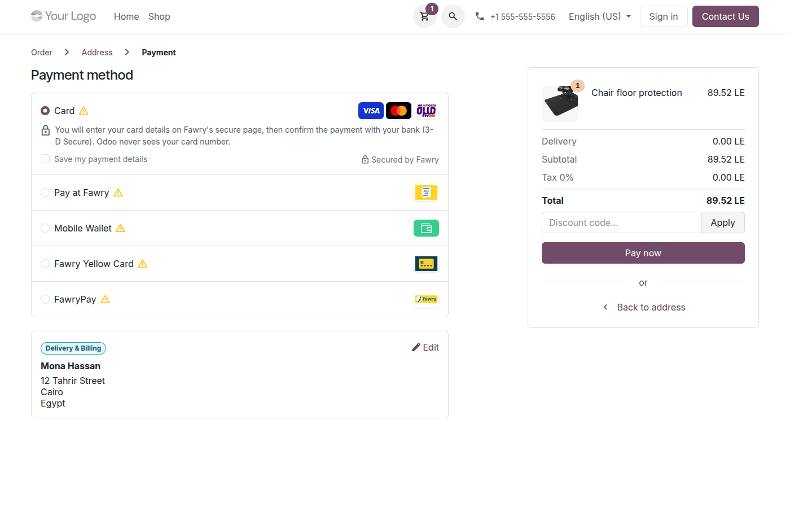
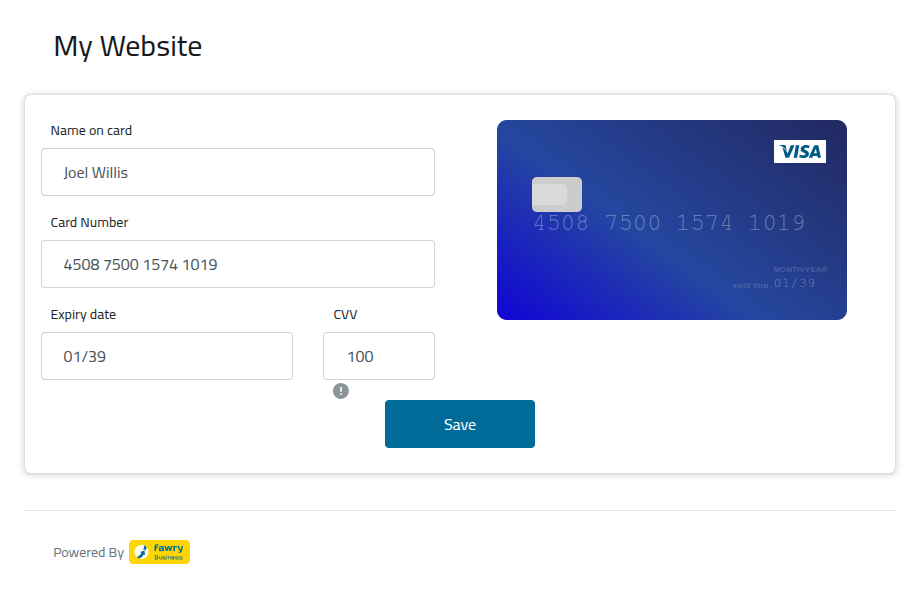
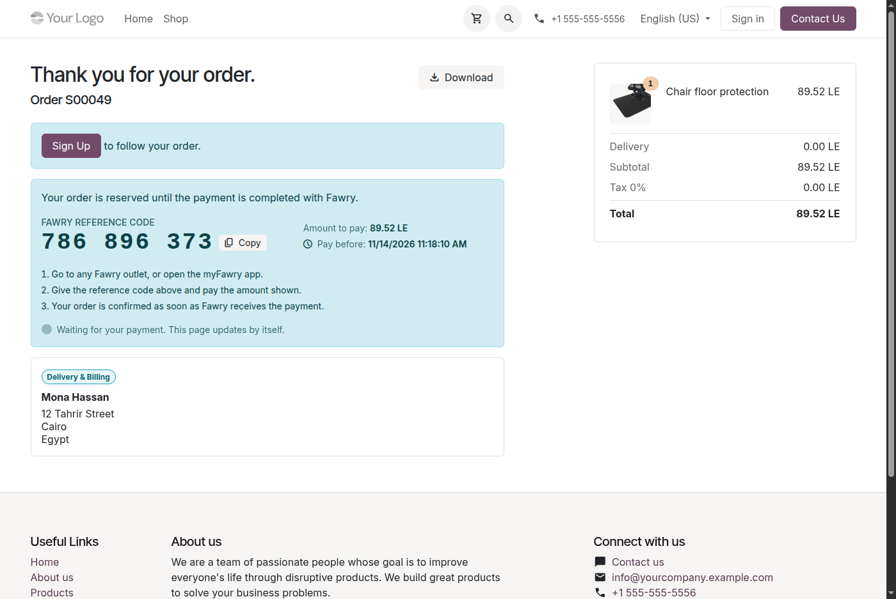
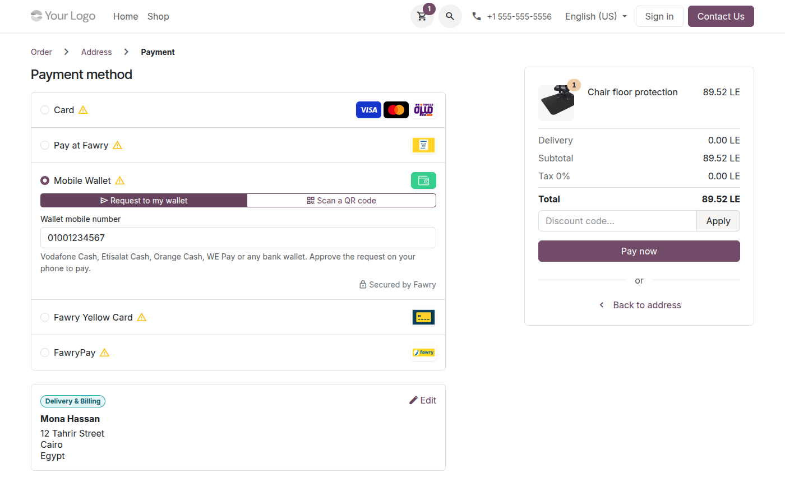
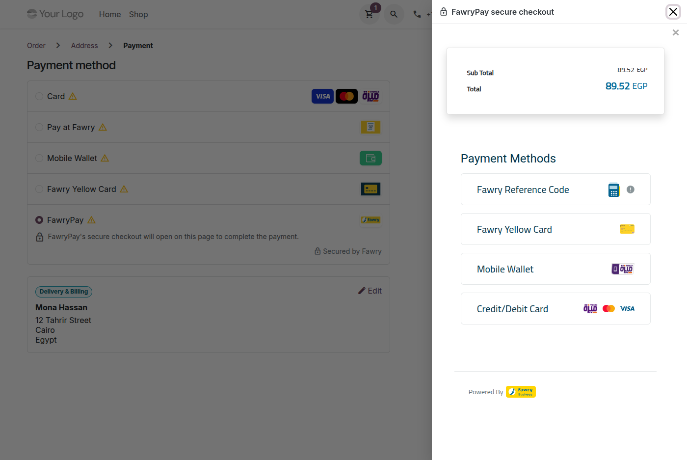
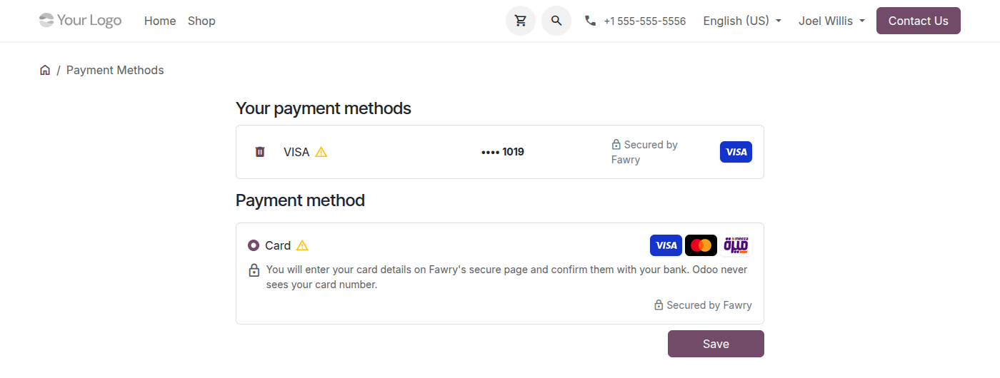
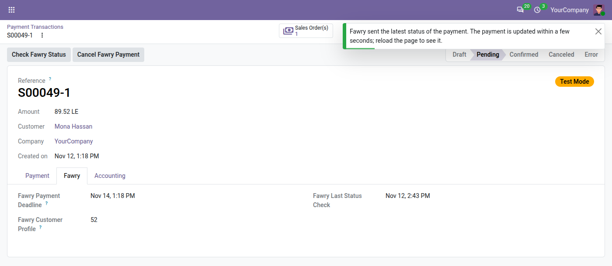
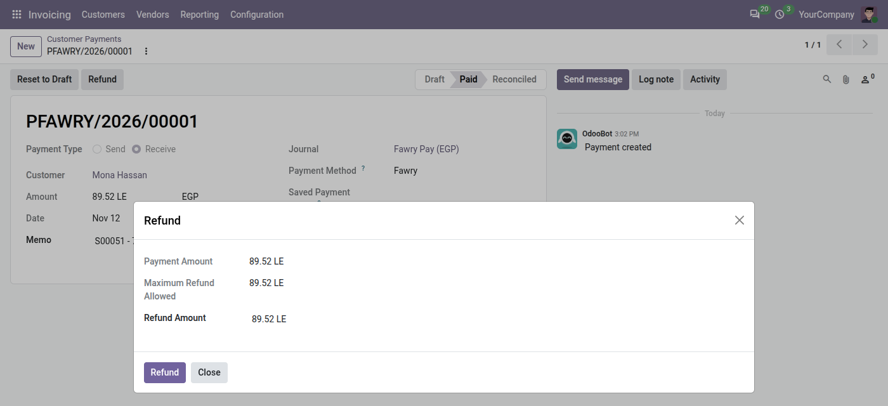

# Fawry Payments: user guide

For the people who work with Fawry payments every day (sales, accounting, customer service) and to know what
customers see. Setting the module up is in the [administrator guide](admin_guide.md).

## Contents

- [What customers see](#what-customers-see)
- [Find a payment](#find-a-payment)
- [Check a payment at Fawry](#check-a-payment-at-fawry)
- [Cancel an unpaid reference code](#cancel-an-unpaid-reference-code)
- [Refund a payment](#refund-a-payment)
- [Send a payment link](#send-a-payment-link)
- [Saved cards](#saved-cards)
- [Answering customers](#answering-customers)

## What customers see

The Fawry methods appear at the payment step of the shop, on invoices in the customer portal and on payment
links.

### Card

1. The customer chooses **Card** and clicks **Pay now**.
2. Fawry's secure page opens (or FawryPay's checkout, with the Express integration). The customer types the card
   details there, never on our website.
3. The customer confirms the payment with their bank (3-D Secure).
4. Back on the website, the order is confirmed: "Your payment has been processed."

### Pay at Fawry (cash)

1. The customer chooses **Pay at Fawry** and places the order.
2. The confirmation page shows the Fawry reference code with a **Copy** button, the amount, the deadline and the
   steps to pay. The code is also on the order in the customer's portal.
3. The customer pays the code at any Fawry outlet or in the myFawry app before the deadline.
4. The page updates by itself when Fawry receives the payment, and the order is confirmed.

### Mobile wallet

The customer chooses **Mobile Wallet**, then either:

- **Request to my wallet**: types the wallet number (Vodafone Cash, Etisalat Cash, Orange Cash, WE Pay or a bank
  wallet) and approves the request on the phone with the wallet PIN; or
- **Scan a QR code**: scans the code shown on the confirmation page with the wallet app.

The order is confirmed as soon as the payment is approved. **myFawry** works the same way, with a QR code and a
link that opens the myFawry app.

### FawryPay checkout (pop-up or side panel)

Fawry Yellow Card, valU, Forsa, Souhoola and FawryPay (every method of our account) are paid on FawryPay's
checkout, which opens in a full page, a pop-up window or a side panel, as set by the administrator.

### Saved cards

With the Server-to-Server integration, signed-in customers can tick **Save my payment details** when they pay by
card, or add a card from **My Account › Payment Methods**. They pay the next orders with it, confirmed with their
bank, and can delete it; it is then deleted at Fawry too.

Everything works on phones and in Arabic, right to left.

## Find a payment

- From the **sales order**: the **Payments** smart button.
- From the **invoice**: the **Payment Transaction** smart button.
- From the provider (**Invoicing › Configuration › Payment Providers › Fawry**): the **Transactions** smart
  button.
- Paid orders: **Invoicing › Customers › Payments**, journal **Fawry Pay**.

On the transaction:

- the **Provider Reference** is the Fawry reference number, the one the customer sees;
- the **Fawry** tab shows the payment deadline, the wallet number, the fees Fawry added (if any), the customer's
  Fawry profile and the last status check.

## Check a payment at Fawry

A customer says they paid, but the order still waits? Open the transaction and click **Check Fawry Status**. Odoo
asks Fawry for the latest status; reload the page after a few seconds to see the transaction confirmed.

Odoo also checks every pending payment every 15 minutes, so you rarely need the button.

## Cancel an unpaid reference code

If the customer cancels the order, or a reference code, wallet request or myFawry payment should no longer be
paid, click **Cancel Fawry Payment** on the pending transaction and confirm. Fawry cancels it and the customer
can no longer pay it. Unpaid codes also expire by themselves after the payment expiry time (48 hours by default).

## Refund a payment

1. Open the payment (**Invoicing › Customers › Payments**) and click **Refund**.
2. Keep the full amount, or type a smaller one for a partial refund, then click **Refund**.
3. Odoo sends the refund to Fawry and records it as a refund transaction and an outgoing payment in Fawry Pay. If
   Fawry refuses it, Odoo shows Fawry's reason and nothing is recorded.

You can refund several times, up to the amount paid. Card refunds go back to the customer's card.

## Send a payment link

For an order or invoice paid outside the shop, use **Generate a Payment Link** in the action menu of the sales
order or the invoice. The customer opens it and pays with any Fawry method. If a reference code expired, send a
new link: each payment attempt gets a new code.

## Saved cards

The **Tokens** smart button of the Fawry provider lists the saved cards (last four digits only). Archiving a card
in Odoo deletes it at Fawry too.

## Answering customers

| The customer says | What to do |
|---|---|
| "I paid at Fawry but my order is still waiting." | Click **Check Fawry Status** on the transaction. If Fawry has the payment, the order is confirmed within a few seconds. |
| "I lost my reference code." | It is on the order in their portal, and on the transaction (**Provider Reference**). |
| "My code expired." | Send a new payment link. |
| "I want to cancel my order." | Cancel the order and, if the code is still unpaid, click **Cancel Fawry Payment**. If it was paid, refund it. |
| "My card was declined." | The transaction shows Fawry's reason. The customer can try another card or another method. |
| "Can you take my card number by phone?" | No. Card numbers are only typed on Fawry's secure page; send a payment link instead. |
