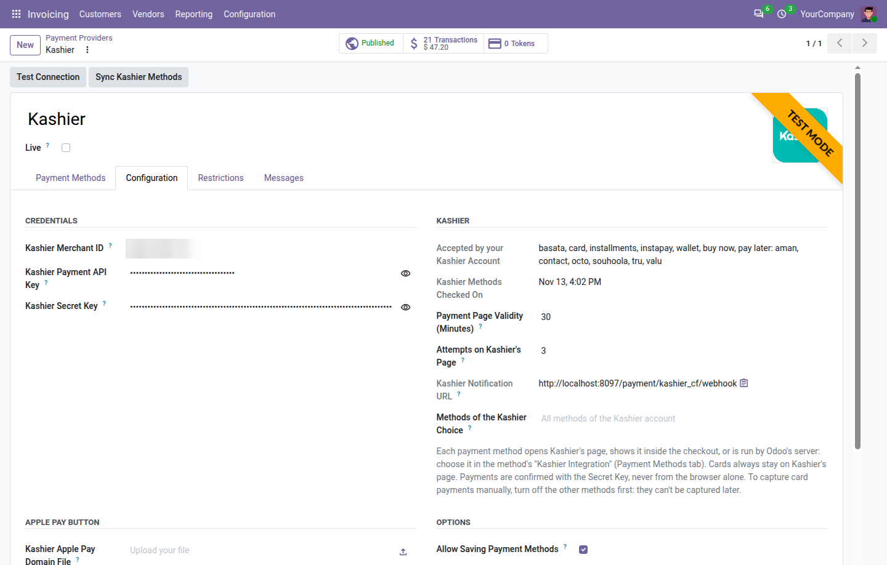
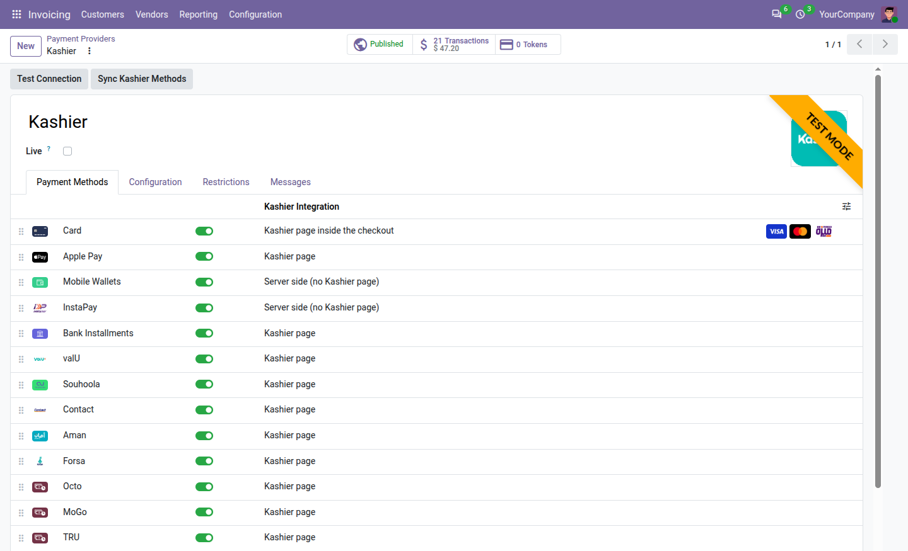
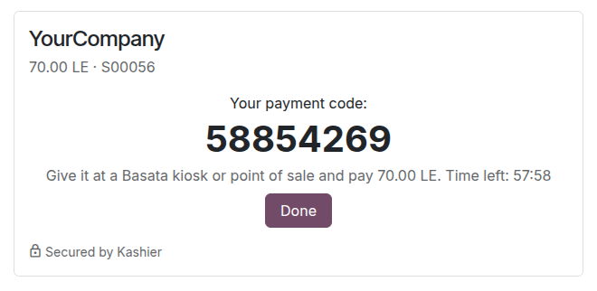

# Kashier Payments: administrator guide

How to set up and run the **Kashier Payments** module (`payment_kashier_cf`, version 20.0.1.1.0) on Odoo 20. For
the daily tasks of your team and what customers see, read the [user guide](user_guide.md).

## Contents

- [How it works](#how-it-works)
- [Before you start](#before-you-start)
- [1. Install the module](#1-install-the-module)
- [2. Get your Kashier keys](#2-get-your-kashier-keys)
- [3. Enter the keys and test the connection](#3-enter-the-keys-and-test-the-connection)
- [4. Choose the payment methods](#4-choose-the-payment-methods)
- [5. Choose how each method reaches Kashier](#5-choose-how-each-method-reaches-kashier)
- [6. Choose the Kashier options](#6-choose-the-kashier-options)
- [7. Check the notification URL](#7-check-the-notification-url)
- [8. Testing in Kashier's test mode](#8-testing-in-kashiers-test-mode)
- [9. Go live](#9-go-live)
- [Upgrading from 20.0.1.0.0](#upgrading-from-200100)
- [Server-side payments](#server-side-payments)
- [Bank installments](#bank-installments)
- [Saved cards](#saved-cards)
- [Authorize, capture and void](#authorize-capture-and-void)
- [Refunds](#refunds)
- [How the status reaches Odoo](#how-the-status-reaches-odoo)
- [Payment statuses](#payment-statuses)
- [Unknown outcomes and late payments](#unknown-outcomes-and-late-payments)
- [Alerts for your team](#alerts-for-your-team)
- [Settings reference](#settings-reference)
- [Accounting](#accounting)
- [Several companies or databases](#several-companies-or-databases)
- [Security](#security)
- [Troubleshooting](#troubleshooting)

## How it works

Kashier is an Egyptian payment gateway. The module connects it to Odoo's payment engine. Each method Kashier
offers is a payment method of its own in Odoo, so customers pick it directly: at checkout, on a quotation, order or
invoice in the customer portal (**Accept & Pay**, **Pay Now**), or on a payment link.

| Payment method | What the customer pays with |
|---|---|
| **Card** | Visa, Mastercard and Meeza (Egypt's national card), confirmed with the bank (3-D Secure). The card paid with is recorded on the payment. |
| **Apple Pay** | Apple Pay, on Apple devices. |
| **Mobile Wallets** | An Egyptian mobile wallet (Vodafone Cash, Orange Cash, e& cash, WE Pay and the others). |
| **InstaPay** | Egypt's instant transfer network: a QR code scanned with a bank app, or a request sent to the customer's InstaPay address. |
| **Bank Installments** | A card paid in installments, on the plans of the customer's bank. |
| **valU**, **Souhoola**, **Contact**, **Aman**, **Forsa**, **Octo**, **MoGo**, **TRU** | Buy now, pay later. |
| **Kiosk (Basata)** | Cash, with a code given at a Basata kiosk or point of sale. |
| **Kashier** | One choice for all the methods of your Kashier account, picked on Kashier's page. It comes from the first version of the module and isn't turned on by the installation any more. |

Card accepts EGP, USD, GBP and EUR (Meeza: EGP only), and so does the **Kashier** choice. The other methods are
offered to customers in Egypt paying in EGP.

Each method reaches Kashier in one of four ways, its **Kashier Integration** (see
[step 5](#5-choose-how-each-method-reaches-kashier)):

- **Kashier page**, the default: the customer goes to Kashier's secure page (`payments.kashier.io`), pays there with
  the method they chose, and comes back to your website. The page shows the store name of your Kashier account and
  opens in Arabic or English, following the customer's language.
- **Kashier page inside the checkout**: the same page, shown inside the payment step, without leaving your website.
- **Server side (no Kashier page)**, for Mobile Wallets, InstaPay and Kiosk (Basata): Odoo starts the payment with
  Kashier itself and shows its own page: the mobile number to send a wallet request to, the InstaPay QR code, or the
  Basata code.
- **Apple Pay button on the payment step (beta)**: Kashier's Apple Pay button appears in the payment step.

Whatever the way:

1. Card numbers are typed only on Kashier's page and never reach Odoo, so the card data (PCI) scope stays with
   Kashier.
2. Odoo takes neither the browser's nor the notification's word for the outcome. It asks Kashier for the status with
   your Secret Key, checks the amount and the currency, and only then confirms the order, posts the payment in the
   **Kashier** journal and reconciles the invoice.
3. A scheduled action checks unfinished payments every 15 minutes, in case a notification was missed.

Also included: refunds from Odoo, full or partial; authorize then capture for cards; saved cards, also charged
without the customer for invoices and subscriptions; and the methods your Kashier account doesn't accept are hidden
by themselves.

## Before you start

- A Kashier merchant account. Its dashboard has a test mode and a live mode, each with its own keys. Use the test
  mode until Kashier has activated your live account.
- The methods you want, enabled on your Kashier account: wallets, InstaPay, Basata, installments and each
  buy-now-pay-later brand are enabled by Kashier, one by one.
- Your Odoo website reachable from the internet over HTTPS, so that Kashier can bring customers back and send its
  notifications.
- Prices in EGP, USD, GBP or EUR on your website pricelist (EGP for every method but cards).
- The Invoicing app with a chart of accounts, for the Kashier journal.
- An outgoing mail server, for the email that gives customers their Basata code.
- The scheduled actions running: Odoo applies Kashier's answers through its payment processing cron, and the module
  checks unfinished payments and lists your account's methods through its own.

## 1. Install the module

1. Add the `codefish_payment_provider` folder to `addons_path` and restart Odoo.
2. Turn on developer mode, open **Apps › Update Apps List**, search for **Kashier Payments** and click
   **Activate**.

The installation:

- adds the **Kashier** provider in each company, in test mode and unpublished, with every payment method turned on
  except the **Kashier** choice, each with the integration **Kashier page**;
- creates a **Kashier** bank journal (code `KASHR`) in each company with a chart of accounts and sets it as the
  provider's **Payment Journal** (see [Accounting](#accounting));
- adds two scheduled actions: **Kashier: check unfinished payments**, every 15 minutes, and **Kashier: list the
  methods of the Kashier accounts**, every day;
- adds the email template **Kashier: Basata payment code**.

Already using version 20.0.1.0.0? Read [Upgrading from 20.0.1.0.0](#upgrading-from-200100).

## 2. Get your Kashier keys

Odoo needs three values from Kashier's dashboard. Switch the dashboard to **test mode** first: the test mode and the
live mode have different keys.

| Field in Odoo | Where in Kashier's dashboard | What Odoo does with it |
|---|---|---|
| **Kashier Merchant ID** | Shown under your name, in the form `MID-123-456` | Names your account in every payment, and lists the methods your account accepts |
| **Kashier Payment API Key** | **Integrate now › Payment API keys** | Opens the payment sessions, and signs the requests about saved cards and the server-side payments. Kashier signs its notifications with it, so Odoo checks them with it too. |
| **Kashier Secret Key** | **Integrate now › Secret key** | Reads the status of every payment, and sends refunds, captures and voids. The dashboard user who owns this key needs Kashier's refund permission for refunds. |

Keep the two keys private: never send them by email or chat, not even to support.

## 3. Enter the keys and test the connection

1. Open **Invoicing › Configuration › Online Payments** (or **Website › Configuration › Payments**) and click
   **Kashier**.
2. Leave **Live** unticked: the provider then works with Kashier's test mode.
3. In the **Configuration** tab, group **Credentials**, paste the Merchant ID, the Payment API Key and the Secret
   Key of the test mode. Spaces around them are removed. Odoo refuses a Merchant ID that doesn't look like
   `MID-123-456`.
4. Save, then click **Test Connection** at the top of the form. Odoo asks Kashier to check the Secret Key and the
   Payment API Key of the provider's mode, and shows "Kashier accepted the Secret Key and the Payment API Key (test
   mode)". When Kashier refuses them, the message gives the reason (see [Troubleshooting](#troubleshooting)).

**Test Connection** doesn't check the Merchant ID: **Sync Kashier Methods** (next step) and your first test payment
do. Only administrators (Settings access) see the two keys, as hidden password fields. With **Live** ticked, the
three fields are required.

## 4. Choose the payment methods

The **Payment Methods** tab of the provider lists the Kashier methods, each with its switch and its **Kashier
Integration**.

1. Click **Sync Kashier Methods** at the top of the form. Odoo asks Kashier which methods your account accepts (the
   Merchant ID is enough) and shows the answer in the **Kashier** group of the **Configuration** tab, under
   **Accepted by your Kashier Account**, for example "basata, card, installments, instapay, wallet, buy now, pay
   later: aman, contact, valu", with the date in **Kashier Methods Checked On**.
2. In **Payment Methods**, turn off the methods you don't want to offer.
3. Choose how each method reaches Kashier ([step 5](#5-choose-how-each-method-reaches-kashier)).

### Methods your account doesn't accept are hidden

Customers never see a method that Kashier would refuse, even when it is turned on in Odoo:

- Until the first sync, nothing is hidden: **Accepted by your Kashier Account** shows "Not checked yet: every active
  method is offered."
- The scheduled action **Kashier: list the methods of the Kashier accounts** asks Kashier again every day. A method
  Kashier enables later shows at checkout after the next run, or at once after **Sync Kashier Methods**.
- Changing the Merchant ID, or ticking or unticking **Live**, forgets the list (it belongs to another account or
  mode) and asks Kashier again in the background, shortly after you save.
- When Kashier doesn't answer, the last list is kept.
- Apple Pay follows cards: it is hidden when your account doesn't accept cards. It is also left out on browsers that
  can't pay with Apple Pay.
- The **Kashier** choice is never hidden: Kashier's page offers what the account has.

### The Kashier choice

The **Kashier** method is one choice that opens Kashier's page with every method of your account (or the ones set in
**Methods of the Kashier Choice**, see [step 6](#6-choose-the-kashier-options)). Now that each method is its own,
it is off after installation. If you turn it on next to the other methods, customers find some methods twice: on
their own and inside Kashier's page.

### Another provider showing the same method

Odoo lists each kind of payment method once. When another published provider of the company offers the same
method, for example Mobile Wallets or valU from our Paymob or Fawry module, and comes before Kashier in the list of
providers (a lower sequence), customers get that provider's method, not Kashier's. The Kashier form then shows a
warning naming these methods: "…: customers see these methods from another payment provider with a lower sequence."

To offer Kashier's instead, turn the method off in the other provider, or move Kashier up: open the payment
providers in list view and drag Kashier above the other provider.

Administrators can check what customers see: at the payment step, the bug icon next to **Payment method** opens
Odoo's availability report, which gives the reason for each hidden method ("Not accepted by the Kashier account",
"Payment method with duplicate code" for a method shown by another provider).

## 5. Choose how each method reaches Kashier

Each method has a **Kashier Integration**:

| Kashier Integration | What the customer sees after **Pay now** |
|---|---|
| **Kashier page** (default) | Kashier's secure page, in the same window, for the chosen method; then back to your website. |
| **Kashier page inside the checkout** | The same page, shown inside the payment step or the portal's payment dialog, without leaving your website. The bank's confirmation (3-D Secure) happens inside it too. Once the payment is over, the customer goes on to the confirmation as usual; closing Kashier's page brings back the list of methods. |
| **Server side (no Kashier page)** | Odoo's own page, with your company's name, the amount and the reference, asking for what the method needs. See [Server-side payments](#server-side-payments). |
| **Apple Pay button on the payment step (beta)** | Kashier's Apple Pay button, in the payment step. See [The Apple Pay button](#the-apple-pay-button-beta). |

Which method allows which:

| Method | Kashier page | Inside the checkout | Server side | Apple Pay button |
|---|---|---|---|---|
| Card (Visa, Mastercard, Meeza) | Yes | Yes | No | No |
| Apple Pay | Yes | No: Apple doesn't allow Apple Pay inside another site's frame | No | Yes |
| Mobile Wallets | Yes | Yes | Yes | No |
| InstaPay | Yes | Yes | Yes | No |
| Kiosk (Basata) | Yes | Yes | Yes | No |
| Bank Installments | Yes | Yes | No | No |
| valU, Souhoola, Contact, Aman, Forsa, Octo, MoGo, TRU | Yes | Yes | No | No |
| Kashier | Yes | Yes | No | No |

**To change it**: in the **Payment Methods** tab, the **Kashier Integration** column shows the setting of each method.
Click the method to open it, choose its **Kashier Integration** and save. Odoo refuses a combination the method
doesn't allow, for example: 'Card can't use the integration "Server side (no Kashier page)" with Kashier. Possible:
Kashier page, Kashier page inside the checkout.' The card brands (Visa, Mastercard, Meeza) follow Card.

Good to know:

- A payment with a saved card always opens Kashier's page, whatever the setting: Kashier asks for the card's
  security code there.
- With **Kashier page**, Apple Pay opens Kashier's card page, where Apple devices offer Apple Pay.
- While Kashier's page is shown inside the checkout, Odoo also checks the payment every 5 seconds, so the customer
  moves on even if the page doesn't hand over by itself.

### The Apple Pay button (beta)

The button lets customers pay with Apple Pay without leaving your website: they click **Pay**, then Kashier's
Apple Pay button that appears under the method. Apple only shows it on a domain registered for Apple Pay.

1. Ask Kashier to register your shop's domain (for example `shop.example.com`) for Apple Pay. Kashier sends you a
   file named `apple-developer-merchantid-domain-association`.
2. On the Kashier provider, **Configuration** tab, group **Apple Pay button**, upload that file in **Kashier Apple
   Pay Domain File**, as Kashier sent it: don't rename, open or edit it. Odoo refuses a file that can't be Apple's
   (larger than 100 KB, or not text).
3. Odoo serves the file at `https://<your domain>/.well-known/apple-developer-merchantid-domain-association`. The
   link shows under the file (**Kashier Apple Pay Domain File URL**): open it, it must show a long line of text.
   Tell Kashier the file is online, so that they can finish the registration.
4. Open the **Apple Pay** method, set its **Kashier Integration** to **Apple Pay button on the payment step (beta)**,
   and make sure the method is on.
5. Check it on an iPhone, iPad or Mac, in Safari, with a card in Apple Wallet. Kashier's test mode can't run Apple
   Pay: with the provider live, make a small payment and refund it before you rely on the button.

Notes:

- Without the file, Apple Pay keeps opening on Kashier's page, even when set to the button.
- The same address serves the Apple Pay file of our Paymob module and of Odoo's Stripe connector. When a Kashier
  provider has a file, Kashier's file is the one served. With several websites, each with its own Kashier provider,
  each domain gets the file of its website's provider.
- When Kashier's Apple Pay script can't load or Apple Pay fails, the customer reads "Apple Pay isn't available right
  now. Choose another payment method." and can choose another method.
- The button is in beta: it relies on Kashier's Apple Pay script, which Odoo can't test for you.

### Why cards never run server side

Card details are typed only on Kashier's page: in its own window, inside the checkout, or to confirm a saved card. A
shop that takes card numbers on its own pages falls under the card industry's security standard (PCI DSS), with its
audits; on Kashier's page, that stays Kashier's job. So Card, and Bank Installments, which are paid with a card,
offer only the two page integrations.

### Why Odoo's cart Express Checkout isn't offered

Odoo's eCommerce can show quick payment buttons in the cart: the customer pays with a wallet such as Apple Pay, and
Odoo takes the delivery address from it. Kashier can't do that: its Apple Pay button doesn't give the customer's
address back, and the amount is fixed when Kashier's session is created, so it can't follow a change of delivery
method. Kashier's methods therefore show at the payment step only. The quick ways to pay with Kashier are its page
inside the checkout and the Apple Pay button.

## 6. Choose the Kashier options

The **Kashier** group of the **Configuration** tab:

| Setting | Default | What it does |
|---|---|---|
| **Accepted by your Kashier Account**, **Kashier Methods Checked On** | Read-only | The methods your account accepts, and when Kashier last listed them (see [step 4](#4-choose-the-payment-methods)). |
| **Payment Page Validity (Minutes)** | 30 | How long the customer can pay on Kashier's page: 5 to 1440 minutes. When the page expires without a payment, the payment is cancelled in Odoo (and still watched for a late payment, see [below](#unknown-outcomes-and-late-payments)). It is also how long Odoo's own page of a [server-side payment](#server-side-payments) waits for the customer to send a request. |
| **Attempts on Kashier's Page** | 3 | How many times the customer can try again on Kashier's page after a declined card: 1 to 5. After the last attempt, the payment fails. |
| **Kashier Notification URL** | Read-only | See [step 7](#7-check-the-notification-url). |
| **Methods of the Kashier Choice** | Empty | For the **Kashier** choice only: the methods Kashier's page offers, as Kashier names them, separated by commas. A method may be narrowed to a brand in square brackets: `wallet, bnpl[valu]` offers mobile wallets and valU only. Empty: every method enabled on your Kashier account. The other methods ignore it. |

Odoo checks how **Methods of the Kashier Choice** is written, not whether Kashier knows the names: after a change,
pay once with the **Kashier** choice to see what the page offers.

The **Apple Pay button** group holds the domain file of [the Apple Pay button](#the-apple-pay-button-beta).

Odoo's own options in the same tab and the next ones:

- **Allow Saving Payment Methods**: signed-in customers may save their card ([Saved cards](#saved-cards)).
- **Capture Amount Manually**: cards are authorized at checkout and captured later
  ([Authorize, capture and void](#authorize-capture-and-void)). Only possible with Card as the only method.
- **Payment Journal**: **Kashier** by default.
- **Restrictions** tab: minimum and maximum amounts, currencies, countries, for the whole provider.
- **Messages** tab: the texts customers read after paying. The pending message is "Your payment is being
  confirmed. Your order is reserved in the meantime."

## 7. Check the notification URL

**Kashier Notification URL** shows `https://<your website>/payment/kashier_cf/webhook`. Odoo sends it to Kashier
with every payment, on Kashier's page or server side, so there is nothing to enter in Kashier's dashboard. Kashier
calls it when a payment changes; Odoo checks the signature, refuses a notification whose signature is wrong, and asks
Kashier for the status.

The address must start with `https://` and open from the internet. It is built from your website's address (system
parameter `web.base.url`). Behind a reverse proxy that handles HTTPS, run Odoo with `proxy_mode` on, so that the
address keeps `https`.

Without notifications, payments are still confirmed, only later: when the customer comes back from Kashier's page,
while Odoo's own pages wait for the payment, and by the 15-minute check.

## 8. Testing in Kashier's test mode

While the provider is unpublished, its methods show on your website only to your own team, signed in with their
Odoo user. In test mode, Odoo shows a warning sign next to the Kashier methods, and Kashier's page shows a test mode
badge. No real money moves.

Kashier wants `https` addresses: test on a server reachable over HTTPS from the internet, or through an HTTPS
tunnel to your computer with `web.base.url` set to the tunnel's address, so that the notifications arrive too.

Click **Sync Kashier Methods** first: the test account may accept other methods than your live one.

What we found in Kashier's test mode (November 2026):

| To test | What to do, and what happens |
|---|---|
| A successful card payment | Card 5123 4500 0000 0008, expiry 12/30, CVC 100. On the 3-D Secure test page, choose the successful answer ("(Y) …") and click **Submit**. |
| A declined card | The same card with expiry 04/27: declined as an expired card (code 54). The customer stays on Kashier's page and may try again. |
| An outcome decided later | The same card with expiry 05/37: Kashier first answers that the outcome is unknown (code CC) and decides later. The payment waits as pending in the meantime. |
| A mobile wallet, on Kashier's page or server side | Number 01001001001: Kashier approves the request by itself, after about 20 seconds. Number 01010101010: refused (Kashier code `k_default`). |
| Buy now, pay later | Kashier refuses small amounts as "not allowed": 10 EGP was refused, 1,500 EGP was accepted. The test account offered valU, Souhoola, Aman, Contact and TRU. |
| Bank installments | Kashier's test page shows "No plans available": an installment payment can't be completed in test mode. |
| Kiosk (Basata), server side | A code is generated, shown and emailed, but it can't be paid in test mode. The payment is cancelled when the code expires. |
| InstaPay | Kashier has to enable InstaPay on the test account first. On ours it wasn't: Kashier refused with error 20906. |
| Apple Pay | Not available in test mode (see [the Apple Pay button](#the-apple-pay-button-beta)). |

Also worth trying: leave the page at the 3-D Secure step (the payment is cancelled when the page validity ends);
pay with a method shown inside the checkout; save a card, then pay again with it; refund a payment from Odoo, partly
then fully; pay in Arabic.

## 9. Go live

1. In Kashier's dashboard, switch to live mode and copy the live keys.
2. In Odoo, tick **Live** (this also publishes the provider), enter the live keys and save. Live keys only work with
   **Live** ticked, test keys only without.
3. Click **Test Connection**: the message now says "live mode".
4. Click **Sync Kashier Methods**: ticking **Live** forgot the methods of the test account. Check **Accepted by your
   Kashier Account**.
5. Place one small real order and refund it from Odoo. With the Apple Pay button, pay once with it on an Apple
   device too.

Ticking or unticking **Live** archives the cards saved with this provider, as Odoo does for every provider: cards
saved in test mode can't be used live.

## Upgrading from 20.0.1.0.0

Version 20.0.1.0.0 had two methods, **Card** and **Kashier**. Version 20.0.1.1.0 adds a method for each Kashier
method. When you update the module:

- Apple Pay, Mobile Wallets, InstaPay, Bank Installments, the eight buy-now-pay-later brands and Kiosk (Basata) are
  added to the Kashier provider of every company, each with the integration **Kashier page**.
- On a provider that isn't published yet, they are turned on.
- On a **published** provider they stay off: your customers keep seeing exactly what they saw before until you
  turn them on. Odoo's server log names each provider left this way.
- **Card** and **Kashier** keep their state and settings. The former **Kashier Methods** setting is now labelled
  **Methods of the Kashier Choice** and still narrows that choice.
- The daily list of your account's methods and the Basata email template are added.

Then, on each published provider:

1. Click **Sync Kashier Methods**.
2. In **Payment Methods**, turn on the methods you want and choose their **Kashier Integration**.
3. Decide about the **Kashier** choice: keep it, or turn it off so that methods don't show twice.

With **Capture Amount Manually** ticked, only Card can be on: Odoo refuses to turn on the others.

## Server-side payments

With **Server side (no Kashier page)**, Mobile Wallets, InstaPay and Kiosk (Basata) are run by Odoo: it asks Kashier
for the payment and the customer stays on your website. After **Pay now**, Odoo's page shows your company's name,
the amount and the order reference, and asks for what the method needs:

| Method | The customer | Then |
|---|---|---|
| Mobile Wallets | Types the wallet's mobile number (11 digits starting with 010, 011, 012 or 015) and clicks **Send the payment request**. The number is filled in when the customer's phone is an Egyptian mobile. | Kashier sends a payment request to the wallet app. The page counts down 10 minutes and moves on to the confirmation by itself once the customer approves. |
| Kiosk (Basata) | Types their mobile number and clicks **Get my payment code**. | Kashier gives an 8-digit code, valid about an hour (Kashier sets the time). The page shows it with a countdown; the customer also gets it by email and finds it again on their order. They pay in cash at a Basata kiosk or point of sale; Odoo confirms the order when Kashier reports the payment. |
| InstaPay | Clicks **Show the QR code**, or types their InstaPay address (`name@instapay`) and clicks **Send the request to my InstaPay**. | The QR code, drawn by Odoo, is scanned with a bank's app or InstaPay; the request is approved in the InstaPay app. Both are valid 15 minutes. The page counts down and moves on by itself once paid. |

The rules:

- **Three attempts.** A customer can try up to 3 times for one payment (for example after a number without a
  wallet), at least 20 seconds apart. Only one request runs at a time: a double click or a second tab never sends a
  second one. After the third attempt: "Too many attempts. Start the payment again from your order."
- **Each attempt is its own order at Kashier.** A refused attempt is kept and still checked, so that a late payment
  of an earlier attempt is never missed.
- **The page waits for the customer** for the **Payment Page Validity** (30 minutes by default) until a request is
  sent. A customer who leaves without sending one: the payment is cancelled when the page expires, or put in error
  with the reason of the last refusal (for example "This mobile number has no wallet.").
- **Expired requests.** When the wallet request, the Basata code or the InstaPay QR or request expires unpaid, the
  payment is cancelled ("The wallet request expired before the payment.", "The payment code expired before the
  payment.", "The InstaPay request expired before the payment.") and still watched for 48 hours for a late payment.
- **Wallets.** While a wallet payment waits, the 15-minute check also asks Kashier to check the request with the
  wallet's operator, in case its answer got lost.
- **No answer from Kashier.** A request Kashier doesn't answer is never sent again: the page says "Checking the
  payment with Kashier..." and the payment follows Kashier's answer (see
  [Unknown outcomes](#unknown-outcomes-and-late-payments)).
- **Notifications.** Kashier notifies Odoo of these payments too, signed like the others.

### The Basata email

Once Kashier gives the code, Odoo emails it to the customer with the template **Kashier: Basata payment code**, in
the customer's language. The subject is "*Your company*: your payment code *12345678*"; the email gives the amount,
the order reference, the code and the time it is valid until. It is sent from your company's email address through
Odoo's outgoing mail queue, to the email address of the customer's contact (no address, no email).

The email matters most for invoices paid from the portal or a payment link: the customer may not come back to a page
that shows the code. While the code is unpaid, the payment status of the order in the customer portal shows it
again: "Your Basata payment code: *12345678*. Pay it at a Basata kiosk or point of sale before *date*." To change the
email, edit the template in **Settings › Technical › Email Templates** (developer mode).

## Bank installments

When a customer pays in installments, their bank approves the plan, then Kashier completes the payment. Meanwhile
the payment waits as **Pending**: "The bank approved the installments. Kashier completes the payment." It is never
shown as authorized, so it is never offered for capture or void. If Kashier hasn't completed it after 3 days, your
team gets one alert: "Kashier hasn't completed this installment payment after 3 days. Check the order in Kashier's
dashboard."

Kashier reports installments as card payments; Odoo keeps **Bank Installments** as the payment method.

## Saved cards

With **Allow Saving Payment Methods** ticked:

- **Saving a card.** A signed-in customer paying with **Card** ticks **Save my payment details**. Kashier saves
  the card with the payment; Odoo keeps only Kashier's token, the last four digits and the expiry date. Kashier
  saves cards during a paid checkout only, so it isn't offered on the customer's **Payment Methods** page to add a
  card without paying.
- **Paying again, customer present.** The customer chooses the saved card in the payment form. Kashier's page
  opens with that card, in its own window whatever Card's integration, and asks only for its CVC, then for 3-D
  Secure.
- **Charging without the customer** (merchant-initiated): an invoice payment registered with the saved card, or a
  subscription renewal. There is no CVC and no 3-D Secure. Kashier refuses this for Meeza cards: Odoo doesn't send
  the charge and says "Meeza cards can't be charged automatically". When a bank still wants its customer to confirm,
  the charge is refused and the customer must pay online.
- **Deleting a card.** When the customer deletes the card on their **Payment Methods** page, or your team clicks
  **Delete at Kashier** on the saved card, it is deleted at Kashier too and can't be charged again. Archiving a card
  for any other reason (ticking **Live**, archiving the provider) keeps it at Kashier.

The **Tokens** smart button of the provider lists the saved cards.

## Authorize, capture and void

1. Make sure authorize and capture is enabled on your Kashier account; if not, ask Kashier.
2. In the **Payment Methods** tab, turn off every method but **Card**, then tick **Capture Amount Manually**. Odoo
   refuses manual capture while another method is on: only cards can be captured later. Wallets, InstaPay, Basata,
   installments and buy now, pay later are paid at once.
3. Card payments then wait as **Authorized**. Capture them (the full amount: Kashier payments can't be captured
   partly) or void them from the order, the invoice or the transaction.

## Refunds

What can be refunded from Odoo depends on the method the customer paid with:

| Method | Refund |
|---|---|
| Card, Apple Pay, Mobile Wallets, Bank Installments | From Odoo: **Refund** on the payment, for the full amount or a part, several times up to the amount paid. A wallet refund from Odoo was checked with Kashier's test account. |
| valU and the other buy-now-pay-later brands, InstaPay, Kiosk (Basata) | In Kashier's dashboard only: Odoo shows no **Refund** button for them. Odoo notes the refund on the order or invoice (see below); record it by hand. |
| Kashier (the choice) | Once paid, the payment shows the method the customer actually used (for example Mobile Wallets or valU), and that method's rule applies. |

- **From Odoo**: Odoo sends the refund to Kashier and records it as its own transaction. A payment captured later is
  refunded on its capture.
- **Refused refunds**: Kashier refuses a refund larger than what remains to refund. The refund transaction is then
  in error with Kashier's explanation, and nothing is refunded.
- **Refunds made in Kashier's dashboard**: when Odoo next reads that payment from Kashier (for example when Kashier
  notifies it), it writes a note on the order or invoice, once per refund: "Kashier refunded … of this payment
  outside Odoo (Kashier transaction …)". Record such a refund in Odoo by hand, with a credit note and an outgoing
  payment in the Kashier journal. Don't use the **Refund** button for it: it would send a second refund to Kashier.

At Kashier, a fully refunded order keeps the status "captured", with its refund lines. In Odoo, the payment stays
confirmed and each refund is a transaction of its own.

## How the status reaches Odoo

Odoo never takes the status of a payment from the browser or from a notification. Each of the following only makes
Odoo ask Kashier, with the Secret Key, for the payment session and the orders of the payment (with a server-side
payment, the orders of every attempt):

1. **The customer comes back** from Kashier's page, or finishes on it inside the checkout.
2. **Odoo's own pages wait for the payment**: the page inside the checkout and the page of a server-side payment
   ask every few seconds while the customer is on them.
3. **Kashier's notification** reaches the notification URL. A notification with a wrong signature is refused (HTTP
   403).
4. **The scheduled action** "Kashier: check unfinished payments", every 15 minutes, for the payments still open on
   Kashier's page (2 days), pending (10 days) or authorized (32 days), server-side payments until 48 hours after
   their request expired, the cancelled ones still watched for a late payment, and the operations whose outcome is
   unknown; up to 200 per run. For a pending wallet payment, it also asks Kashier to check the request with the
   wallet's operator.
5. **Check Kashier Status** on the transaction, shown until the payment is confirmed or in error. The payment is
   updated within a few seconds; reload the page.

Kashier is asked at most once every 10 seconds per payment, except when the customer comes back. The amount and the
currency Kashier reports must match the payment; otherwise the payment goes into error and your team is alerted.

## Payment statuses

| At Kashier | Payment in Odoo |
|---|---|
| Page created or open | Draft: the customer is on Kashier's page |
| Card declined, page still valid | Draft: the customer may try again |
| Wallet request sent, Basata code or InstaPay QR given | Pending: the customer has to approve or pay |
| Installments approved by the bank | Pending, until Kashier completes the payment |
| Paid | Confirmed. The payment method becomes the one used: the card's brand for cards, or Mobile Wallets, valU, Kiosk (Basata)… **Paid With (Kashier)** shows the card, e.g. "Mastercard 512345******0008", or the method. Apple Pay paid with the button keeps **Apple Pay**; Apple Pay paid on Kashier's page shows the card's brand, as Kashier reports it like a typed card. |
| Authorized (cards) | Authorized |
| Declined, page ended | Error, with the reason, e.g. "The card has expired." |
| Page expired or abandoned, nothing paid | Cancelled: "The payment page expired before the payment." Still watched for 48 hours |
| Wallet request, Basata code or InstaPay request expired unpaid | Cancelled, e.g. "The wallet request expired before the payment." Still watched for 48 hours |
| Not decided yet | Pending |
| Cancelled or reversed | Cancelled. A payment already confirmed stays confirmed, and your team is alerted |
| Refunded, fully or partly | Confirmed; each refund is its own transaction |

As soon as a payment is pending, customers are taken to their order page, which shows the pending message (and the
Basata code, for a Basata payment).

## Unknown outcomes and late payments

**Unknown outcomes are never retried.** When Kashier doesn't answer a request that moves money (a refund, a
capture, a void, a charge of a saved card without the customer, or a server-side payment request) because of a
timeout, a lost connection or an error on Kashier's side, Odoo doesn't send it again: the money could move twice.
The transaction:

- waits as **Pending** ("Waiting for Kashier's answer."), with **Kashier Outcome Unknown** ticked in its **Kashier**
  tab;
- is checked 2 minutes later, then every 15 minutes, and follows Kashier's answer as soon as there is one;
- after **2 hours** without an answer, goes into **Error**: "Kashier didn't confirm this operation. Check it in
  Kashier's dashboard before trying again."

**Payments Kashier hasn't decided** (Kashier itself waits for the bank) stay pending. Once Kashier's page or the
server-side request has ended and the outcome is still open, your team gets one note and one activity on the order
or invoice; the payment keeps being checked.

**Late payments.**

- A payment cancelled because Kashier's page, the wallet request, the Basata code or the InstaPay request expired is
  still checked for 48 hours. If the customer paid after all, the payment is confirmed and a note says so.
- A charge of a saved card without the customer that Kashier accepts after Odoo marked it failed is not revived:
  the invoice payment was already cancelled. Your team gets an activity to register the payment by hand.

## Alerts for your team

Problems that need a person are written as a note on the order or invoice and, once per payment and kind of
problem, as a **To-Do** activity "Check the Kashier payment *reference*" for the salesperson of the order or invoice,
when there is one. The [user guide](user_guide.md#alerts-and-activities) lists them, with what to do; this version
adds the alert about installments not completed after 3 days.

Kashier's own codes and messages are shown to your team only, in the **Kashier** tab of the transaction (**Kashier
Error Code**, **Kashier Error Details**). Customers see card, bank and wallet problems explained ("The card has
expired.", "This mobile number has no wallet."), and other problems as a neutral message with a code to give you.
Texts for customers name your company, never Odoo.

## Settings reference

| Setting | What it does |
|---|---|
| **Live** | Unticked: Kashier's test mode, no real money. Ticked: live payments; also publishes the provider. |
| **Kashier Merchant ID** | Your account, `MID-123-456`. |
| **Kashier Payment API Key**, **Kashier Secret Key** | The keys of the provider's mode. Only administrators see them. |
| **Test Connection** | Asks Kashier to check the two keys. |
| **Sync Kashier Methods** | Asks Kashier which methods the account accepts; also done every day. |
| **Accepted by your Kashier Account**, **Kashier Methods Checked On** | The answer, and its date. The other methods are hidden at checkout. |
| **Payment Page Validity (Minutes)** | 30 by default, 5 to 1440. Also the wait on Odoo's page of a server-side payment. |
| **Attempts on Kashier's Page** | 3 by default, 1 to 5. |
| **Kashier Notification URL** | Read-only; sent with every payment. |
| **Methods of the Kashier Choice** | What the **Kashier** choice offers. Empty: every method of your account. |
| **Kashier Apple Pay Domain File** | Kashier's file for the Apple Pay button, served at `/.well-known/apple-developer-merchantid-domain-association`. |
| **Kashier Integration** (on each method) | Kashier page, Kashier page inside the checkout, Server side (no Kashier page), Apple Pay button on the payment step (beta). |
| **Allow Saving Payment Methods** | Customers may save their card while paying with **Card**. |
| **Capture Amount Manually** | Authorize, then capture or void. Needs every method but **Card** turned off. |
| **Payment Journal** | Where payments and refunds are posted. **Kashier** by default. |

## Accounting

Each company gets a **Kashier** bank journal, code `KASHR`, without a currency, because Kashier takes EGP, USD, GBP
and EUR. Its name is "كاشير" in the Arabic languages installed when it is created. It is the provider's **Payment
Journal**: when Kashier confirms a payment, whatever the method, Odoo posts a customer payment there and reconciles
the invoice; refunds are posted there as outgoing payments.

- The balance of the journal is the money Kashier collected for you and hasn't paid out yet: record Kashier's
  payouts as internal transfers to your bank account, and Kashier's fees as bank fees.
- A company without a chart of accounts gets the journal when its chart is installed.
- A bank journal already using the code `KASHR` is reused. If the code belongs to another kind of journal, the
  provider keeps the journal it has: choose one by hand.
- Uninstalling the module keeps the journal and its entries.

## Several companies or databases

- Each company has its own Kashier provider: enter the keys on each one, and sync its methods. Each company gets its
  own Kashier journal.
- Several companies, or several databases (for example two shops, or production and a staging copy), can use the
  same Kashier account. Every order reference Odoo sends to Kashier carries a code of the database and a random
  part, so references never clash and each database acts on its own payments only. A notification about another
  database's order is acknowledged and ignored.
- A neutralized copy of the database loses the three Kashier credentials, so that it can't take or refund real
  payments.

## Security

- **No card data in Odoo.** Card numbers are typed on Kashier's page only, never on Odoo's pages. A saved card is
  kept as Kashier's token, its last four digits and its expiry date.
- **Customers only go to Kashier.** Odoo sends customers, or shows inside the checkout, only Kashier's payment page
  (`payments.kashier.io`) and refuses any other address. The checkout only listens to messages from that page.
- **Status from Kashier's API.** The return and the notifications are signed by Kashier; the signatures are checked
  (a wrong one is refused), but their content is never used. Odoo reads the status with the Secret Key and checks
  the amount and the currency.
- **Return and server-side pages.** The address the customer comes back to, and the page of a server-side payment,
  are tied to the payment by a secret token.
- **Keys.** Only administrators see the Payment API Key and the Secret Key.
- **Logs.** Kashier keys, signatures, card tokens, masked card numbers, customers' wallet numbers, InstaPay
  addresses and InstaPay QR contents are masked in Odoo's logs, including the request log of the customer's return
  from Kashier.

## Troubleshooting

| Problem | What to check |
|---|---|
| No Kashier method is offered at checkout | The provider is published (or you are signed in as staff); the website pricelist is in EGP, USD, GBP or EUR (EGP for every method but cards); the **Restrictions** tab allows the order. |
| A method is on, but customers don't see it | **Your Kashier account doesn't accept it**: look at **Accepted by your Kashier Account**, click **Sync Kashier Methods**, and ask Kashier to enable the method. **Another provider shows it**: the warning on the Kashier form names it; turn it off there or move Kashier up. Also: methods other than cards are for customers in Egypt paying in EGP; Apple Pay shows only on browsers that can pay with it. Signed in as an administrator, the bug icon next to **Payment method** gives the reason. |
| **Accepted by your Kashier Account**: "Not checked yet" | Click **Sync Kashier Methods**. "Kashier didn't answer" means Kashier couldn't be reached: try again later; until then, every active method is offered. |
| InstaPay: customers get an error with the code 20906 | InstaPay isn't enabled on your Kashier account (the **Kashier** tab of the transaction says so). Ask Kashier to enable it, or turn InstaPay off. |
| valU or another buy-now-pay-later brand: Kashier says "not allowed" | The amount is below the brand's minimum. Odoo has no minimum per method: customers choose another method for small orders. |
| The Apple Pay button doesn't appear | The **Apple Pay** method is set to **Apple Pay button on the payment step (beta)** and the domain file is uploaded (without it, Apple Pay opens Kashier's page); the link under the file shows a long line of text; Kashier finished registering your domain. The customer is on an iPhone or iPad, or in Safari on a Mac (Apple Pay is hidden elsewhere), has a card in Apple Wallet, and clicked **Pay** first: the button appears after it. |
| Apple Pay: "Apple Pay isn't available right now" | Kashier's Apple Pay script didn't load or refused the payment. Check the domain registration with Kashier. |
| A wallet payment stays pending | The customer hasn't approved the request in the wallet app yet. The request is valid 10 minutes; then the payment is cancelled, and still watched for 48 hours. |
| A server-side payment: "Too many attempts" | The customer used the 3 attempts of this payment: they start again from their order, or you send a payment link. |
| The customer didn't get the Basata email | The customer's contact has an email address; your outgoing mail server works. The code also shows on their order in the portal. |
| An installment payment stays pending | Normal until Kashier completes it. After 3 days your team is alerted: check the order in Kashier's dashboard. |
| "… can't use the integration … with Kashier" | That method doesn't allow it: see the table of [step 5](#5-choose-how-each-method-reaches-kashier). |
| **Test Connection**: "Kashier refused the credentials" | The keys belong to the provider's mode: test keys with **Live** unticked, live keys with it ticked. Copy them again from Kashier's dashboard. |
| "Kashier refused the server's IP address" | Add your Odoo server's IP address to the allowed IP addresses in Kashier's dashboard. |
| "The Kashier account is not live yet" | Keep **Live** unticked until Kashier activates your account. |
| Customers get an error with the code `INVALID_HASH_CHECK` | The Payment API Key and the Merchant ID. |
| Notifications don't reach Odoo | The **Kashier Notification URL** must start with `https://` and open from the internet: check `web.base.url`, `proxy_mode` behind a proxy, and your firewall. Payments are still confirmed on the customer's return, by Odoo's waiting pages and by the 15-minute check. |
| Notifications are refused (HTTP 403) | The Payment API Key in Odoo must be the current one of the provider's mode: Kashier signs its notifications with it. |
| A payment stays pending | Click **Check Kashier Status** and look at the **Kashier** tab. **Kashier Outcome Unknown** means Kashier didn't answer: Odoo keeps checking, for up to 2 hours. Otherwise Kashier hasn't decided yet: check the order in Kashier's dashboard. Make sure the scheduled action **Kashier: check unfinished payments** is active. |
| There is no **Refund** button on a payment | The customer paid with a buy-now-pay-later brand, InstaPay or Basata: refund in Kashier's dashboard, then record it by hand. |
| A refund is refused: "larger than what can still be refunded" | Part of the payment was already refunded, perhaps in Kashier's dashboard. Refund at most what remains. |
| A refund is refused: a permission is missing | The Kashier dashboard user who owns the Secret Key needs the refund permission. |
| **Capture Amount Manually** is refused, or a method can't be turned on | Manual capture works with **Card** alone: turn off every other method first, or untick **Capture Amount Manually**. |
| A capture is refused: authorize and capture isn't enabled | Ask Kashier to enable it, or untick **Capture Amount Manually**. |
| Charging a saved card without the customer: "Meeza cards can't be charged automatically" | Kashier doesn't allow it for Meeza. Send the customer a payment link: they pay online with the card. |
| Charging a saved card: "The bank asks the customer to confirm this payment" | The bank wants 3-D Secure. Send the customer a payment link. |
| An operation is in error: "Kashier didn't confirm this operation" | Kashier didn't answer for 2 hours. Look for it in Kashier's dashboard: if it went through, record it in Odoo by hand; if not, try again. |
| Customers can't save cards | **Allow Saving Payment Methods** is ticked, the customer is signed in and pays with **Card**. Cards can't be added without paying. |

Support: [info@codefish.com.eg](mailto:info@codefish.com.eg). Send your Odoo version and, for a payment issue, the
transaction reference. Never send your keys.

Kashier and its logo are trademarks of their owner, as are the names and logos of the payment methods. This module
is not made by, endorsed by or affiliated with Kashier; the names and logos are used only to show which payment
methods are accepted.
