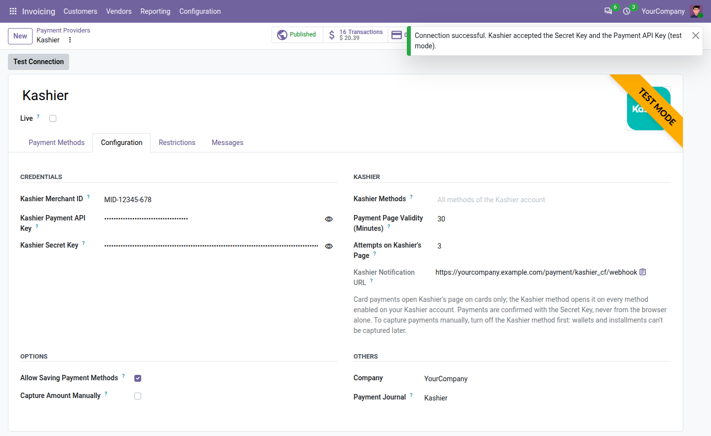
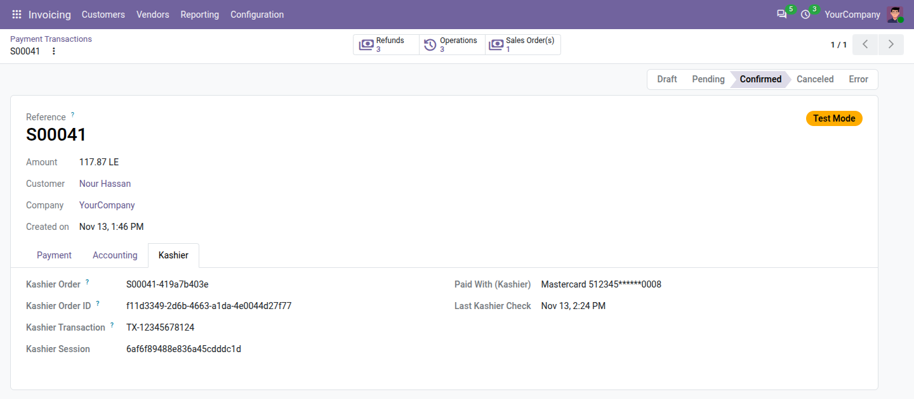

# Kashier Payments: administrator guide

How to set up and run the **Kashier Payments** module (`payment_kashier_cf`) on Odoo 20. For the daily tasks of
your team and what customers see, read the [user guide](user_guide.md).

## Contents

- [How it works](#how-it-works)
- [Before you start](#before-you-start)
- [1. Install the module](#1-install-the-module)
- [2. Get your Kashier keys](#2-get-your-kashier-keys)
- [3. Enter the keys and test the connection](#3-enter-the-keys-and-test-the-connection)
- [4. Choose the Kashier options](#4-choose-the-kashier-options)
- [5. Check the notification URL](#5-check-the-notification-url)
- [6. Testing in Kashier's test mode](#6-testing-in-kashiers-test-mode)
- [7. Go live](#7-go-live)
- [Saved cards](#saved-cards)
- [Authorize, capture and void](#authorize-capture-and-void)
- [Refunds](#refunds)
- [How the status reaches Odoo](#how-the-status-reaches-odoo)
- [Payment statuses](#payment-statuses)
- [Unknown outcomes and late payments](#unknown-outcomes-and-late-payments)
- [Alerts for your team](#alerts-for-your-team)
- [Settings reference](#settings-reference)
- [Accounting](#accounting)
- [Several companies or databases](#several-companies-or-databases)
- [Security](#security)
- [Troubleshooting](#troubleshooting)

## How it works

Kashier is an Egyptian payment gateway. The module connects it to Odoo's payment engine:

1. At checkout, on a quotation, order or invoice in the customer portal, or on a payment link, the customer chooses
   **Card** or **Kashier** and clicks **Pay now**.
2. Odoo opens a payment session at Kashier and sends the customer to Kashier's hosted payment page
   (`payments.kashier.io`). The page shows the store name of your Kashier account and opens in Arabic or English,
   following the customer's language.
3. The customer pays there. Cards are confirmed with the bank (3-D Secure). Card numbers are typed only on
   Kashier's page and never reach Odoo, so the card data (PCI) scope stays with Kashier.
4. Kashier sends the customer back and notifies Odoo. Neither is taken at its word: Odoo asks Kashier for the
   status with your Secret Key, checks the amount and the currency, and only then confirms the order, posts the
   payment in the **Kashier** journal and reconciles the invoice.
5. A scheduled action checks unfinished payments every 15 minutes, in case a notification was missed.

The two payment methods:

| Method | What Kashier's page offers |
|---|---|
| **Card** | The card form only: Visa, Mastercard and Meeza (Egypt's national card), with 3-D Secure. The card paid with is recorded on the payment. |
| **Kashier** | Every method enabled on your Kashier account: cards, mobile wallets, instalments, buy-now-pay-later brands such as valU. You can narrow the list with **Kashier Methods**. |

Currencies: EGP, USD, GBP and EUR (Meeza: EGP only). Also included: refunds from Odoo, full or partial; authorize
then capture; saved cards, also charged without the customer for invoices and subscriptions.

## Before you start

- A Kashier merchant account. Its dashboard has a test mode and a live mode, each with its own keys. Use the test
  mode until Kashier has activated your live account.
- Your Odoo website reachable from the internet over HTTPS, so that Kashier can bring customers back and send its
  notifications.
- Prices in EGP, USD, GBP or EUR on your website pricelist.
- The Invoicing app with a chart of accounts, for the Kashier journal.
- The scheduled actions running: Odoo applies Kashier's answers through its payment processing cron, and the module
  checks unfinished payments through its own.

## 1. Install the module

1. Add the `codefish_payment_provider` folder to `addons_path` and restart Odoo.
2. Turn on developer mode, open **Apps › Update Apps List**, search for **Kashier Payments** and click
   **Activate**.

The installation:

- adds the **Kashier** provider in each company, in test mode and unpublished, with the **Card** and **Kashier**
  methods turned on;
- creates a **Kashier** bank journal (code `KASHR`) in each company with a chart of accounts and sets it as the
  provider's **Payment Journal** (see [Accounting](#accounting));
- adds the scheduled action **Kashier: check unfinished payments**, which runs every 15 minutes.

## 2. Get your Kashier keys

Odoo needs three values from Kashier's dashboard. Switch the dashboard to **test mode** first: the test mode and the
live mode have different keys.

| Field in Odoo | Where in Kashier's dashboard | What Odoo does with it |
|---|---|---|
| **Kashier Merchant ID** | Shown under your name, in the form `MID-123-456` | Names your account in every payment |
| **Kashier Payment API Key** | **Integrate now › Payment API keys** | Opens the payment sessions and signs the requests about saved cards. Kashier signs its notifications with it, so Odoo checks them with it too. |
| **Kashier Secret Key** | **Integrate now › Secret key** | Reads the status of every payment, and sends refunds, captures and voids. The dashboard user who owns this key needs Kashier's refund permission for refunds. |

Keep the two keys private: never send them by email or chat, not even to support.

## 3. Enter the keys and test the connection

1. Open **Invoicing › Configuration › Online Payments** (or **Website › Configuration › Payments**) and click
   **Kashier**.
2. Leave **Live** unticked: the provider then works with Kashier's test mode.
3. In the **Configuration** tab, group **Credentials**, paste the Merchant ID, the Payment API Key and the Secret
   Key of the test mode. Spaces around them are removed. Odoo refuses a Merchant ID that doesn't look like
   `MID-123-456`.
4. Save, then click **Test Connection** at the top of the form. Odoo asks Kashier to check the Secret Key and the
   Payment API Key of the provider's mode, and shows "Kashier accepted the Secret Key and the Payment API Key (test
   mode)". When Kashier refuses them, the message gives the reason (see [Troubleshooting](#troubleshooting)).

**Test Connection** doesn't check the Merchant ID: your first test payment does. Only administrators (Settings
access) see the two keys, as hidden password fields. With **Live** ticked, the three fields are required.

## 4. Choose the Kashier options

The **Kashier** group of the **Configuration** tab:

| Setting | Default | What it does |
|---|---|---|
| **Kashier Methods** | Empty | For the **Kashier** method only: the methods Kashier's page offers, as Kashier names them, separated by commas. A method may be narrowed to a brand in square brackets: `wallet, bnpl[valu]` offers mobile wallets and valU only. Empty: every method enabled on your Kashier account. The **Card** method always offers cards. |
| **Payment Page Validity (Minutes)** | 30 | How long the customer can pay on Kashier's page: 5 to 1440 minutes. When the page expires without a payment, the payment is cancelled in Odoo (and still watched for a late payment, see [below](#unknown-outcomes-and-late-payments)). |
| **Attempts on Kashier's Page** | 3 | How many times the customer can try again on Kashier's page after a declined card: 1 to 5. After the last attempt, the payment fails. |
| **Kashier Notification URL** | Read-only | See [step 5](#5-check-the-notification-url). |

Odoo checks how **Kashier Methods** is written, not whether Kashier knows the names: after a change, pay once with
the **Kashier** method to see what the page offers.

Odoo's own options in the same tab and the next ones:

- **Allow Saving Payment Methods**: signed-in customers may save their card ([Saved cards](#saved-cards)).
- **Capture Amount Manually**: cards are authorized at checkout and captured later
  ([Authorize, capture and void](#authorize-capture-and-void)).
- **Payment Journal**: **Kashier** by default.
- **Restrictions** tab: minimum and maximum amounts, currencies, countries.
- **Messages** tab: the texts customers read after paying. The pending message is "Your payment is being
  confirmed. Your order is reserved in the meantime."

## 5. Check the notification URL

**Kashier Notification URL** shows `https://<your website>/payment/kashier_cf/webhook`. Odoo sends it to Kashier
with every payment, so there is nothing to enter in Kashier's dashboard. Kashier calls it when a payment changes;
Odoo checks the signature, refuses a notification whose signature is wrong, and asks Kashier for the status.

The address must start with `https://` and open from the internet. It is built from your website's address (system
parameter `web.base.url`). Behind a reverse proxy that handles HTTPS, run Odoo with `proxy_mode` on, so that the
address keeps `https`.

Without notifications, payments are still confirmed, only later: when the customer comes back from Kashier's page,
and by the 15-minute check.

## 6. Testing in Kashier's test mode

While the provider is unpublished, its methods show on your website only to your own team, signed in with their
Odoo user. In test mode, Odoo shows a warning sign next to the Kashier methods, and Kashier's page shows a test mode
badge. No real money moves.

Kashier wants `https` addresses: test on a server reachable over HTTPS from the internet, or through an HTTPS
tunnel to your computer with `web.base.url` set to the tunnel's address, so that the notifications arrive too.

What we used in Kashier's test mode:

| To test | On Kashier's page |
|---|---|
| A successful card payment | Card 5123 4500 0000 0008, expiry 12/30, CVC 100. On the 3-D Secure test page, choose the successful answer ("(Y) …") and click **Submit**. |
| A declined card | The same card with expiry 04/27: declined as an expired card (code 54). The customer stays on Kashier's page and may try again. |
| An outcome decided later | The same card with expiry 05/37: Kashier first answers that the outcome is unknown (code CC) and decides later. The payment waits as pending in the meantime. |

Also worth trying: leave the page at the 3-D Secure step (the payment is cancelled when the page validity ends);
save a card, then pay again with it; refund a payment from Odoo, partly then fully; pay with the **Kashier** method
in Arabic.

## 7. Go live

1. In Kashier's dashboard, switch to live mode and copy the live keys.
2. In Odoo, tick **Live** (this also publishes the provider), enter the live keys and save. Live keys only work with
   **Live** ticked, test keys only without.
3. Click **Test Connection**: the message now says "live mode".
4. Place one small real order and refund it from Odoo.

Ticking or unticking **Live** archives the cards saved with this provider, as Odoo does for every provider: cards
saved in test mode can't be used live.

## Saved cards

With **Allow Saving Payment Methods** ticked:

- **Saving a card.** A signed-in customer paying with **Card** ticks **Save my payment details**. Kashier saves
  the card with the payment; Odoo keeps only Kashier's token, the last four digits and the expiry date. Kashier
  saves cards during a paid checkout only, so it isn't offered on the customer's **Payment Methods** page to add a
  card without paying.
- **Paying again, customer present.** The customer chooses the saved card in the payment form. Kashier's page
  opens with that card and asks only for its CVC, then for 3-D Secure.
- **Charging without the customer** (merchant-initiated): an invoice payment registered with the saved card, or a
  subscription renewal. There is no CVC and no 3-D Secure. Kashier refuses this for Meeza cards: Odoo doesn't send
  the charge and says "Meeza cards can't be charged automatically". When a bank still wants its customer to confirm,
  the charge is refused and the customer must pay online.
- **Deleting a card.** When the customer deletes the card on their **Payment Methods** page, or your team clicks
  **Delete at Kashier** on the saved card, it is deleted at Kashier too and can't be charged again. Archiving a card
  for any other reason (ticking **Live**, archiving the provider) keeps it at Kashier.

The **Tokens** smart button of the provider lists the saved cards.

## Authorize, capture and void

1. Make sure authorize and capture is enabled on your Kashier account; if not, ask Kashier.
2. In the **Payment Methods** tab, turn off the **Kashier** method, then tick **Capture Amount Manually**. Odoo
   refuses manual capture while a method that can't be captured later is active, and only **Card** can be:
   wallets, instalments and the other methods of Kashier's page are paid at once.
3. Card payments then wait as **Authorized**. Capture them (the full amount: Kashier payments can't be captured
   partly) or void them from the order, the invoice or the transaction.

## Refunds

- **From Odoo**: **Refund** on the payment, for the full amount or a part, several times up to the amount paid.
  Odoo sends the refund to Kashier and records it as its own transaction. A payment captured later is refunded on
  its capture.
- **Refused refunds**: Kashier refuses a refund larger than what remains to refund. The refund transaction is then
  in error with Kashier's explanation, and nothing is refunded.
- **Refunds made in Kashier's dashboard**: when Odoo next reads that payment from Kashier (for example when Kashier
  notifies it), it writes a note on the order or invoice, once per refund: "Kashier refunded … of this payment
  outside Odoo (Kashier transaction …)". Record such a refund in Odoo by hand, with a credit note and an outgoing
  payment in the Kashier journal. Don't use the **Refund** button for it: it would send a second refund to Kashier.

At Kashier, a fully refunded order keeps the status "captured", with its refund lines. In Odoo, the payment stays
confirmed and each refund is a transaction of its own.

## How the status reaches Odoo

Odoo never takes the status of a payment from the browser or from a notification. Each of the following only makes
Odoo ask Kashier, with the Secret Key, for the payment session and the orders of the payment:

1. **The customer comes back** from Kashier's page.
2. **Kashier's notification** reaches the notification URL. A notification with a wrong signature is refused (HTTP
   403).
3. **The scheduled action** "Kashier: check unfinished payments", every 15 minutes, for the payments still open on
   Kashier's page (2 days), pending (10 days) or authorized (32 days), the cancelled ones still watched for a late
   payment, and the operations whose outcome is unknown; up to 200 per run.
4. **Check Kashier Status** on the transaction, shown until the payment is confirmed or in error. The payment is
   updated within a few seconds; reload the page.

Notifications make Odoo ask Kashier at most once every 10 seconds per payment. The amount and the currency Kashier
reports must match the payment; otherwise the payment goes into error and your team is alerted.

## Payment statuses

| At Kashier | Payment in Odoo |
|---|---|
| Page created or open | Draft: the customer is on Kashier's page |
| Card declined, page still valid | Draft: the customer may try again |
| Paid | Confirmed. The payment method becomes the card's brand (or **Kashier** for the other methods), and **Paid With (Kashier)** shows the card, e.g. "Mastercard 512345******0008" |
| Authorized | Authorized |
| Declined, page ended | Error, with the reason, e.g. "The card has expired." |
| Page expired or abandoned, nothing paid | Cancelled: "The payment page expired before the payment." Still watched for 48 hours |
| Not decided yet | Pending |
| Cancelled or reversed | Cancelled. A payment already confirmed stays confirmed, and your team is alerted |
| Refunded, fully or partly | Confirmed; each refund is its own transaction |

As soon as a payment is pending, customers are taken to their order page, which shows the pending message.

## Unknown outcomes and late payments

**Unknown outcomes are never retried.** When Kashier doesn't answer a request that moves money (a refund, a
capture, a void, or a charge of a saved card without the customer) because of a timeout, a lost connection or an
error on Kashier's side, Odoo doesn't send it again: the money could move twice. The transaction:

- waits as **Pending** ("Waiting for Kashier's answer."), with **Kashier Outcome Unknown** ticked in its **Kashier**
  tab;
- is checked 2 minutes later, then every 15 minutes, and follows Kashier's answer as soon as there is one;
- after **2 hours** without an answer, goes into **Error**: "Kashier didn't confirm this operation. Check it in
  Kashier's dashboard before trying again."

**Payments Kashier hasn't decided** (Kashier itself waits for the bank) stay pending. Once Kashier's page has ended
and the outcome is still open, your team gets one note and one activity on the order or invoice; the payment keeps
being checked.

**Late payments.**

- A payment cancelled because Kashier's page expired is still checked for 48 hours. If the customer paid after all,
  the payment is confirmed and a note says so.
- A charge of a saved card without the customer that Kashier accepts after Odoo marked it failed is not revived:
  the invoice payment was already cancelled. Your team gets an activity to register the payment by hand.

## Alerts for your team

Problems that need a person are written as a note on the order or invoice and, once per payment and kind of
problem, as a **To-Do** activity "Check the Kashier payment *reference*" for the salesperson of the order or invoice,
when there is one. The [user guide](user_guide.md#alerts-and-activities) lists them, with what to do.

Kashier's own codes and messages are shown to your team only, in the **Kashier** tab of the transaction (**Kashier
Error Code**, **Kashier Error Details**). Customers see card and bank problems explained ("The card has expired."),
and other problems as a neutral message with a code to give you. Texts for customers name your company, never Odoo.

## Settings reference

| Setting | What it does |
|---|---|
| **Live** | Unticked: Kashier's test mode, no real money. Ticked: live payments; also publishes the provider. |
| **Kashier Merchant ID** | Your account, `MID-123-456`. |
| **Kashier Payment API Key**, **Kashier Secret Key** | The keys of the provider's mode. Only administrators see them. |
| **Test Connection** | Asks Kashier to check the two keys. |
| **Kashier Methods** | What the **Kashier** method offers. Empty: every method of your account. |
| **Payment Page Validity (Minutes)** | 30 by default, 5 to 1440. |
| **Attempts on Kashier's Page** | 3 by default, 1 to 5. |
| **Kashier Notification URL** | Read-only; sent with every payment. |
| **Allow Saving Payment Methods** | Customers may save their card while paying with **Card**. |
| **Capture Amount Manually** | Authorize, then capture or void. Needs the **Kashier** method turned off. |
| **Payment Journal** | Where payments and refunds are posted. **Kashier** by default. |

## Accounting

Each company gets a **Kashier** bank journal, code `KASHR`, without a currency, because Kashier takes EGP, USD, GBP
and EUR. Its name is "كاشير" in the Arabic languages installed when it is created. It is the provider's **Payment
Journal**: when Kashier confirms a payment, Odoo posts a customer payment there and reconciles the invoice; refunds
are posted there as outgoing payments.

- The balance of the journal is the money Kashier collected for you and hasn't paid out yet: record Kashier's
  payouts as internal transfers to your bank account, and Kashier's fees as bank fees.
- A company without a chart of accounts gets the journal when its chart is installed.
- A bank journal already using the code `KASHR` is reused. If the code belongs to another kind of journal, the
  provider keeps the journal it has: choose one by hand.
- Uninstalling the module keeps the journal and its entries.

## Several companies or databases

- Each company has its own Kashier provider: enter the keys on each one. Each company gets its own Kashier journal.
- Several companies, or several databases (for example two shops, or production and a staging copy), can use the
  same Kashier account. Every order reference Odoo sends to Kashier carries a code of the database and a random
  part, so references never clash and each database acts on its own payments only. A notification about another
  database's order is acknowledged and ignored.
- A neutralized copy of the database loses the three Kashier credentials, so that it can't take or refund real
  payments.

## Security

- **No card data in Odoo.** Card numbers are typed on Kashier's page only. A saved card is kept as Kashier's token,
  its last four digits and its expiry date.
- **Customers only go to Kashier.** Odoo sends customers only to Kashier's payment page (`payments.kashier.io`) and
  refuses any other address.
- **Status from Kashier's API.** The return and the notifications are signed by Kashier; the signatures are checked
  (a wrong one is refused), but their content is never used. Odoo reads the status with the Secret Key and checks
  the amount and the currency.
- **Return page.** The address the customer comes back to is tied to the payment by a secret token.
- **Keys.** Only administrators see the Payment API Key and the Secret Key.
- **Logs.** Kashier keys, signatures, card tokens and masked card numbers are masked in Odoo's logs, including the
  request log of the customer's return from Kashier.

## Troubleshooting

| Problem | What to check |
|---|---|
| Kashier isn't offered at checkout | The provider is published (or you are signed in as staff) and the method is on; the website pricelist is in EGP, USD, GBP or EUR (Meeza: EGP); the **Restrictions** tab allows the order. |
| **Test Connection**: "Kashier refused the credentials" | The keys belong to the provider's mode: test keys with **Live** unticked, live keys with it ticked. Copy them again from Kashier's dashboard. |
| "Kashier refused the server's IP address" | Add your Odoo server's IP address to the allowed IP addresses in Kashier's dashboard. |
| "The Kashier account is not live yet" | Keep **Live** unticked until Kashier activates your account. |
| Customers get an error with the code `INVALID_HASH_CHECK` | The Payment API Key and the Merchant ID. |
| Notifications don't reach Odoo | The **Kashier Notification URL** must start with `https://` and open from the internet: check `web.base.url`, `proxy_mode` behind a proxy, and your firewall. Payments are still confirmed on the customer's return and by the 15-minute check. |
| Notifications are refused (HTTP 403) | The Payment API Key in Odoo must be the current one of the provider's mode: Kashier signs its notifications with it. |
| A payment stays pending | Click **Check Kashier Status** and look at the **Kashier** tab. **Kashier Outcome Unknown** means Kashier didn't answer: Odoo keeps checking, for up to 2 hours. Otherwise Kashier hasn't decided yet: check the order in Kashier's dashboard. Make sure the scheduled action **Kashier: check unfinished payments** is active. |
| A refund is refused: "larger than what can still be refunded" | Part of the payment was already refunded, perhaps in Kashier's dashboard. Refund at most what remains. |
| A refund is refused: a permission is missing | The Kashier dashboard user who owns the Secret Key needs the refund permission. |
| **Capture Amount Manually** is refused | Turn off the **Kashier** method first. |
| A capture is refused: authorize and capture isn't enabled | Ask Kashier to enable it, or untick **Capture Amount Manually**. |
| Charging a saved card without the customer: "Meeza cards can't be charged automatically" | Kashier doesn't allow it for Meeza. Send the customer a payment link: they pay online with the card. |
| Charging a saved card: "The bank asks the customer to confirm this payment" | The bank wants 3-D Secure. Send the customer a payment link. |
| An operation is in error: "Kashier didn't confirm this operation" | Kashier didn't answer for 2 hours. Look for it in Kashier's dashboard: if it went through, record it in Odoo by hand; if not, try again. |
| Customers can't save cards | **Allow Saving Payment Methods** is ticked, the customer is signed in and pays with **Card**. Cards can't be added without paying. |

Support: [info@codefish.com.eg](mailto:info@codefish.com.eg). Send your Odoo version and, for a payment issue, the
transaction reference. Never send your keys.

Kashier and its logo are trademarks of their owner. This module is not made by, endorsed by or affiliated with
Kashier; the name and the logo are used only to show that the payment method is accepted.
