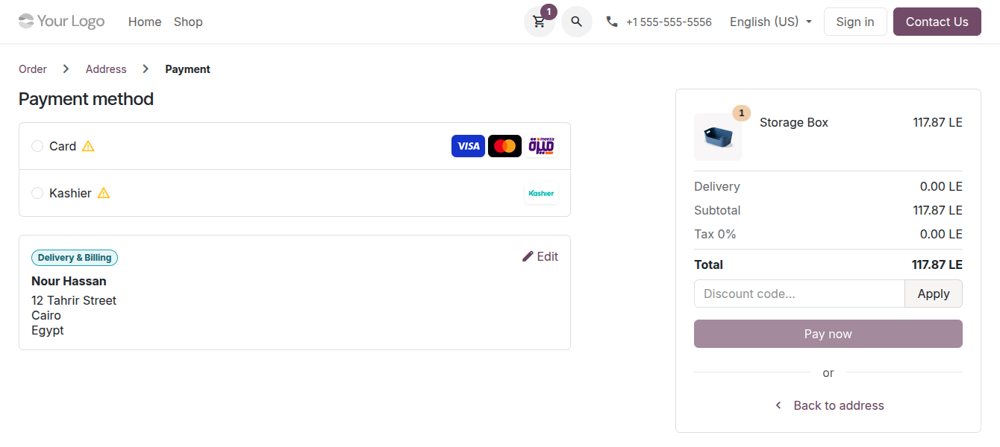
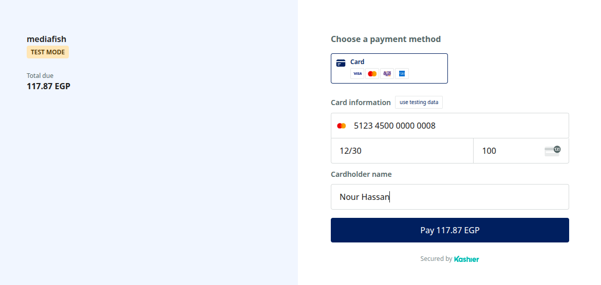
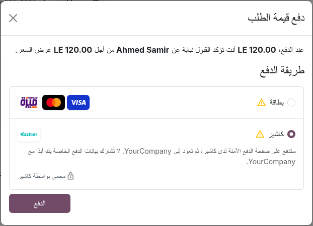
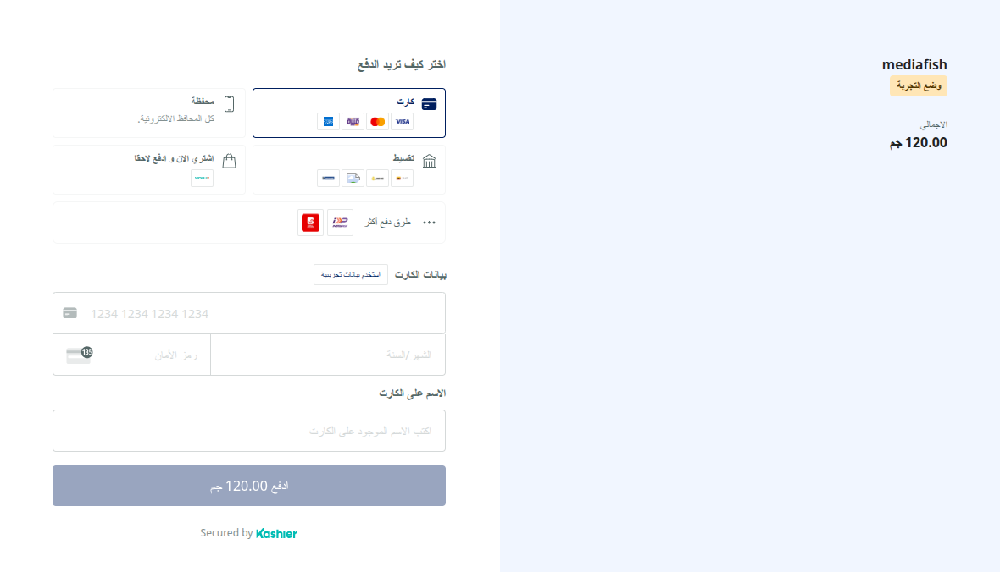
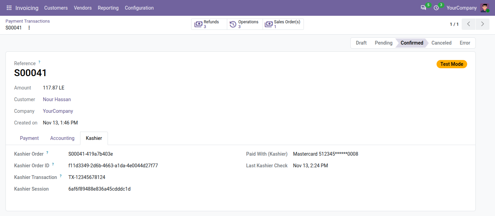
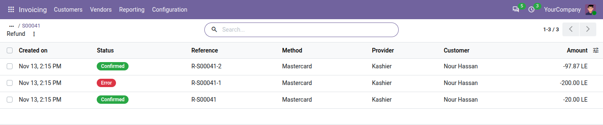
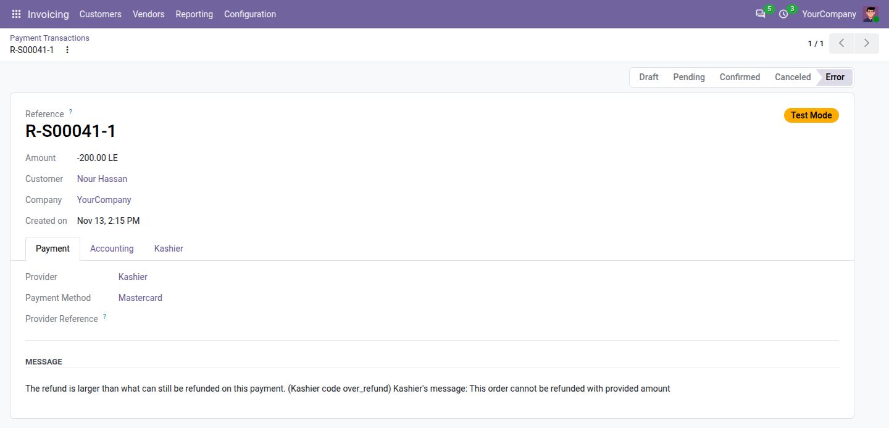
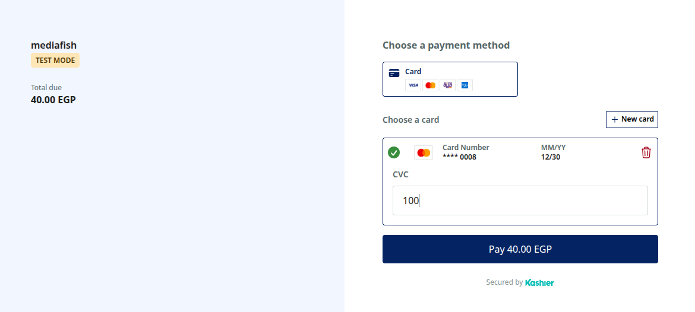

# Kashier Payments: user guide

For the people who work with Kashier payments every day (sales, accounting, customer service), and to know what
customers see. Setting the module up is in the [administrator guide](admin_guide.md).

## Contents

- [What customers see](#what-customers-see)
- [Find a payment](#find-a-payment)
- [Check a payment at Kashier](#check-a-payment-at-kashier)
- [Refund a payment](#refund-a-payment)
- [Capture or void a payment](#capture-or-void-a-payment)
- [Saved cards](#saved-cards)
- [Charge a saved card without the customer](#charge-a-saved-card-without-the-customer)
- [Alerts and activities](#alerts-and-activities)
- [Answering customers](#answering-customers)

## What customers see

The Kashier methods appear at the payment step of the shop, on quotations, orders and invoices in the customer
portal (**Accept & Pay**, **Pay Now**) and on payment links.

1. **Choosing.** The customer chooses **Card** (with the Visa, Mastercard and Meeza logos) or **Kashier**. A hint
   under the method says that they pay on Kashier's secure page and come back to your company, and that their
   payment details are never shared with your company.

   

2. **Kashier's page.** After **Pay now**, the customer goes to Kashier's payment page, in Arabic or English
   following their language, with the store name of your Kashier account and the amount.
   - **Card** shows the card form only. The bank confirms the payment (3-D Secure).
   - **Kashier** shows every method your administrator allows: cards, mobile wallets, instalments, valU and the
     other buy-now-pay-later brands.

   

3. **A declined card.** The customer stays on Kashier's page and may try again, within the number of attempts set
   by your administrator (3 by default) and while the page is valid (30 minutes by default).
4. **Back on your website.** The customer sees the confirmation of the order. When Kashier hasn't confirmed the
   payment yet, they see "Your payment is being confirmed. Your order is reserved in the meantime."; the order is
   updated as soon as Kashier confirms.
5. **Leaving without paying.** The payment is cancelled once Kashier's page expires. The customer can pay the order
   again from their portal.

Card numbers are typed on Kashier's page only: your company and Odoo never see them.

### In Arabic

When the customer browses your website in Arabic, the payment step and the hint are in Arabic, right to left, and
Kashier's page opens in Arabic.

## Find a payment

- From the sales order (**Payments** smart button), the invoice (**Payment Transaction** smart button), or the
  provider (**Transactions**; remove the default filter to see payments that aren't confirmed).
- Confirmed payments: **Invoicing › Customers › Payments**, journal **Kashier**.

The **Kashier** tab of the transaction shows:

| Field | What it is |
|---|---|
| **Kashier Order**, **Kashier Order ID** | The reference sent to Kashier, and Kashier's own number of the order: use them to find the payment in Kashier's dashboard |
| **Kashier Transaction** | Kashier's operation that moved the money (also the transaction's **Provider Reference**) |
| **Paid With (Kashier)** | The card paid with, e.g. "Mastercard 512345******0008", or the method (e.g. a wallet) |
| **Kashier Operation** | On a refund, capture or void: which one |
| **Kashier Outcome Unknown** | Kashier didn't answer a request: Odoo is waiting for its answer (see [below](#alerts-and-activities)) |
| **Last Kashier Check** | When Odoo last asked Kashier for the status |
| **Kashier Error Code**, **Kashier Error Details** | Why Kashier refused: the code, what it means, and Kashier's own message |

## Check a payment at Kashier

A customer says they paid, but the order still waits? Open the transaction and click **Check Kashier Status**,
then reload the page after a few seconds. The button shows until the payment is confirmed or in error.

You rarely need it: Odoo asks Kashier when the customer comes back, when Kashier sends a notification, and every
15 minutes for unfinished payments, refunds, captures and voids.

## Refund a payment

1. Open the payment (**Invoicing › Customers › Payments**) and click **Refund**.
2. Keep the full amount or type a smaller one, then click **Refund**.
3. Odoo sends the refund to Kashier. The refund is its own transaction: **Confirmed** when Kashier accepts it,
   **Pending** while Kashier hasn't answered, **Error** when Kashier refuses it.

You can refund several times, up to the amount paid. When Kashier refuses a refund, for example because it is
larger than what remains to refund, the refund transaction shows Kashier's reason and no money moves.

**A refund made in Kashier's dashboard** isn't sent from Odoo. Odoo notes it on the order or invoice ("Kashier
refunded … of this payment outside Odoo"). Record it by hand: a credit note and an outgoing payment in the
**Kashier** journal. Don't click **Refund** for it: that would refund the customer a second time.

## Capture or void a payment

When your company captures card payments manually, they wait as **Authorized**: the money is reserved on the card,
not taken. On the order, the invoice or the transaction:

- **Capture Transaction** takes the full amount. Kashier payments can't be captured partly.
- **Void Transaction** releases the reserved amount.

## Saved cards

- **Saving.** Signed-in customers paying with **Card** tick **Save my payment details**. Kashier keeps the card;
  Odoo keeps only the last four digits and the expiry date. Cards are saved while paying only, not from the
  customer's **Payment Methods** page.
- **Paying with a saved card.** The customer chooses the card in the payment form; Kashier's page opens with it and
  asks only for the CVC, then the bank's confirmation.

  

- **Removing.** The customer deletes the card from **My Account › Payment Methods**. It is deleted at Kashier too.
- **In the back office.** The **Tokens** smart button of the Kashier provider lists the saved cards. On a card,
  **Delete at Kashier** archives it and deletes it at Kashier: it can't be charged again.

## Charge a saved card without the customer

To collect an invoice with the customer's saved card:

1. On the invoice, click **Register Payment**.
2. Choose the **Kashier** journal and the **Kashier** payment method, then the card in **Saved payment token**.
3. Click **Create Payment**. Kashier charges the card without asking the customer: no CVC, no 3-D Secure.

Subscriptions renew with the saved card the same way, by themselves.

The charge is refused when:

- the card is a **Meeza** card: "Meeza cards can't be charged automatically". Send the customer a payment link
  instead (**Generate a Payment Link** in the action menu of the invoice);
- the bank wants its customer to confirm: "The bank asks the customer to confirm this payment". Send a payment link
  too;
- the bank declines the card: the **Kashier** tab explains why.

When Kashier doesn't answer, the payment waits as pending and Odoo looks for the answer. Never charge the card
again while a charge is pending: see [Alerts and activities](#alerts-and-activities).

## Alerts and activities

When a payment needs a person, Odoo writes a note on the order or invoice and, once per payment and problem, gives
the salesperson a **To-Do** activity "Check the Kashier payment *reference*".

| Note or activity | What happened | What to do |
|---|---|---|
| "Kashier hasn't decided the outcome of this payment…" | The bank hasn't given Kashier the outcome; the payment is pending | Look at the order in Kashier's dashboard. Don't ask the customer to pay again yet: Odoo keeps checking and updates the payment once Kashier decides. |
| "Kashier confirmed a payment whose amount or currency differs from this payment…" | The payment is in error | Compare the two in Kashier's dashboard. Refund the Kashier payment if it is wrong, then ask the customer to pay the right amount. |
| "Kashier has several paid orders for this payment…" | The customer paid more than once; Odoo recorded one payment | Refund the other orders in Kashier's dashboard. The notes about refunds made outside Odoo that follow concern these extra payments, which Odoo never recorded: there is nothing to record for them. |
| "Kashier reversed or cancelled this payment after it was confirmed…" | The money went back at Kashier, but the order is still paid in Odoo | Check the order in Kashier's dashboard, then cancel the order or make a credit note, and record the money that went back. |
| "Kashier charged the saved card after this payment was marked failed. Register the payment of … by hand." | A charge without the customer went through late | Register the payment on the invoice by hand, in the **Kashier** journal. Don't charge the card again. |
| "Kashier's operation amount differs from this transaction." | A refund, capture or void has another amount at Kashier | Check the operation in Kashier's dashboard. |
| Note: "Kashier refunded … of this payment outside Odoo (Kashier transaction …)…" | Someone refunded in Kashier's dashboard | Record it by hand (credit note and outgoing payment in the **Kashier** journal), not with **Refund**. |
| Note: "Kashier confirmed a late payment of this transaction." | The customer paid after the page expired; the order is now paid | Check that the customer didn't pay the order again another way; if they did, refund one of the payments. |

Transactions in error that need you:

| Message | What to do |
|---|---|
| "Kashier didn't confirm this operation. Check it in Kashier's dashboard before trying again." | Kashier didn't answer a refund, capture, void or charge for 2 hours. Find it in Kashier's dashboard: if it went through, record it in Odoo by hand; if not, do it again. |
| "The amount paid at Kashier doesn't match." | See the amount alert above. |

## Answering customers

| The customer says | What to do |
|---|---|
| "I paid but my order is still waiting." | Click **Check Kashier Status** on the transaction. If Kashier hasn't decided yet, tell the customer the order is reserved and will be confirmed once the bank answers. |
| "My card was declined." | The **Kashier** tab explains the code. The customer can try again on Kashier's page, use another card, or choose **Kashier** for another method. |
| "The payment page expired." | The customer pays again from the order in their portal, or you send a payment link. |
| "Can I pay with a wallet, in instalments or with valU?" | Yes, with the **Kashier** method, when your Kashier account offers it. |
| "Why do you ask for the CVC of my saved card?" | Kashier asks for it, and the bank may confirm, at each online payment with a saved card. |
| "How do I remove my card?" | **My Account › Payment Methods**, the bin next to the card. |
| "Can you take my card number by phone?" | No. Send a payment link instead. |
