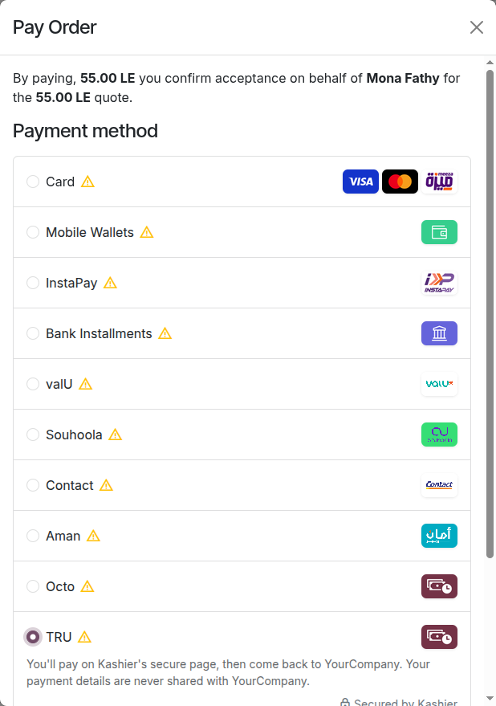
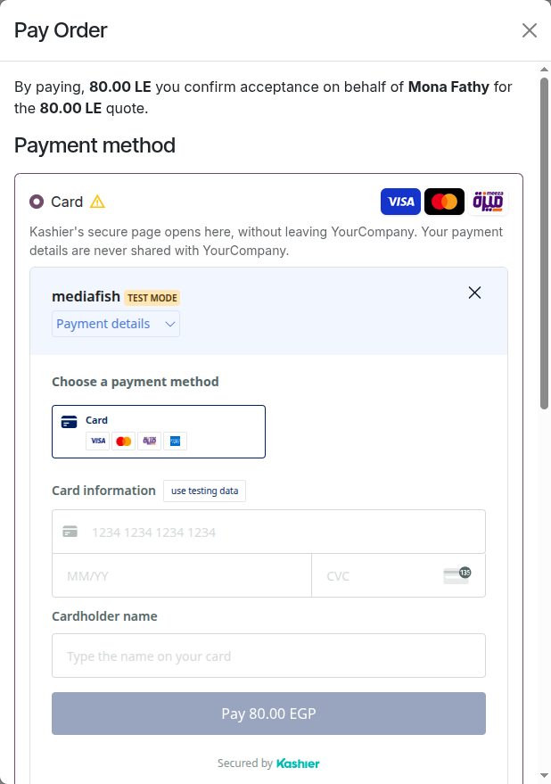
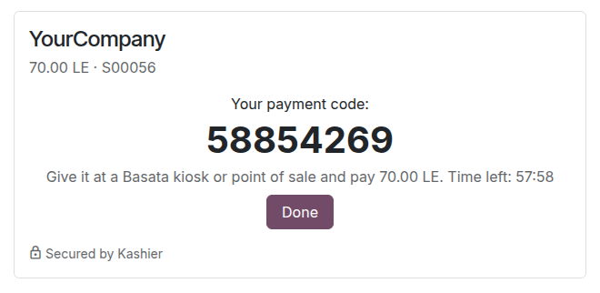

# Kashier Payments: user guide

For the people who work with Kashier payments every day (sales, accounting, customer service), and to know what
customers see. Setting the module up is in the [administrator guide](admin_guide.md).

## Contents

- [What customers see](#what-customers-see)
- [Basata codes](#basata-codes)
- [Find a payment](#find-a-payment)
- [Check a payment at Kashier](#check-a-payment-at-kashier)
- [Refund a payment](#refund-a-payment)
- [Capture or void a payment](#capture-or-void-a-payment)
- [Saved cards](#saved-cards)
- [Charge a saved card without the customer](#charge-a-saved-card-without-the-customer)
- [Alerts and activities](#alerts-and-activities)
- [Answering customers](#answering-customers)

## What customers see

The Kashier methods appear at the payment step of the shop, on quotations, orders and invoices in the customer
portal (**Accept & Pay**, **Pay Now**) and on payment links.

### Choosing a method

Each method your company offers is listed with its logo: **Card** (with the Visa, Mastercard and Meeza logos),
**Apple Pay**, **Mobile Wallets**, **InstaPay**, **Bank Installments**, buy-now-pay-later brands such as **valU**, and
**Kiosk (Basata)**. Some shops also offer **Kashier**, one choice for every method of the Kashier account.

- Customers only see the methods your Kashier account accepts.
- Apple Pay shows only where it can be used: on an iPhone or iPad, or in Safari on a Mac.
- Methods other than cards are offered in EGP, to customers in Egypt.

A hint under the chosen method says what comes next, and that the payment details are never shared with your
company.

### After Pay now

What follows depends on how your administrator set the method (its **Kashier Integration**):

| Set to | What the customer sees |
|---|---|
| **Kashier page** | Kashier's secure payment page, in Arabic or English following their language, with the store name of your Kashier account and the amount. They pay there with the method they chose and come back to your website. The hint says: "You'll pay on Kashier's secure page, then come back to *your company*." |
| **Kashier page inside the checkout** | The same Kashier page, inside the payment step (or the payment dialog of the portal), without leaving your website. The bank's confirmation (3-D Secure) happens inside it too. The cross of Kashier's page closes it and brings back the list of methods. |
| **Server side** (Mobile Wallets, InstaPay, Kiosk (Basata)) | A page of your website, with your company's name, the amount and the order reference. See [below](#wallet-instapay-and-basata-on-your-website). |
| **Apple Pay button** | After **Pay**, Kashier's Apple Pay button appears under the method ("Click Pay, then the Apple Pay button that appears here."). The customer pays with Apple Pay without leaving your website. |

On Kashier's page, **Card** shows the card form only, and the bank confirms the payment (3-D Secure). Card numbers
are typed on Kashier's page only, whichever way it is shown: your company and Odoo never see them.

### Wallet, InstaPay and Basata on your website

When these methods are set to **Server side**, your website's own page takes the customer through the payment:

- **Mobile Wallets**: the customer types their wallet's mobile number (filled in when their phone number is an
  Egyptian mobile) and clicks **Send the payment request**. They approve the request in their wallet app (Vodafone
  Cash, Orange Cash, e& cash, WE Pay…). The page shows "Approve the payment in your wallet app." with a 10-minute
  countdown, and moves on to the confirmation by itself once the payment is done.
- **InstaPay**: the customer clicks **Show the QR code** and scans it with their bank's app or InstaPay, or types
  their InstaPay address (`name@instapay`) and clicks **Send the request to my InstaPay**, then approves the request
  in the app. The QR code and the request are valid 15 minutes; the page counts down and moves on by itself.
- **Kiosk (Basata)**: the customer types their mobile number and clicks **Get my payment code**. The page shows an
  8-digit code and the time left (about an hour). They give the code at a Basata kiosk or point of sale and pay the
  amount in cash. **Done** takes them to the payment status. See [Basata codes](#basata-codes).

If something goes wrong (a number without a wallet, a mistyped number), the page explains it and the customer can try
again: up to 3 times for one payment, 20 seconds apart. After that, they start again from their order.

### Then

1. **A declined card.** On Kashier's page, the customer stays there and may try again, within the number of
   attempts set by your administrator (3 by default) and while the page is valid (30 minutes by default).
2. **Back on your website.** The customer sees the confirmation of the order. When the payment isn't confirmed yet,
   they see "Your payment is being confirmed. Your order is reserved in the meantime."; the order is updated as soon
   as Kashier confirms. For a Basata payment, the code shows there too, until it is paid.
3. **Bank installments.** Once the bank approves the plan, the order waits until Kashier completes the payment; it
   is then confirmed by itself.
4. **Leaving without paying.** The payment is cancelled once Kashier's page, the wallet request, the InstaPay QR or
   the Basata code expires. The customer can pay the order again from their portal.

### In Arabic

When the customer browses your website in Arabic, the payment step, the hints and your website's payment pages are
in Arabic, right to left, and Kashier's page opens in Arabic.

## Basata codes

A Basata payment gives the customer an 8-digit code to pay in cash at a Basata kiosk or point of sale. The customer
gets the code three ways:

- on the payment page, right away;
- by email, in their language: "*Your company*: your payment code *12345678*", with the amount, the order reference
  and the time the code is valid until;
- on their order or invoice in the customer portal, in the payment status: "Your Basata payment code: *12345678*.
  Pay it at a Basata kiosk or point of sale before *date*." It shows until the code is paid.

The code is valid about an hour (Kashier sets the time). When the customer pays it, Kashier tells Odoo and the order
is confirmed. When it expires unpaid, the payment is cancelled; the customer pays the order again and gets a new
code. Odoo still watches the expired code for 48 hours, in case it was paid late.

The code isn't shown in the back office: the customer finds it in the email or on their order. The email needs an
email address on the customer's contact.

## Find a payment

- From the sales order (**Payments** smart button), the invoice (**Payment Transaction** smart button), or the
  provider (**Transactions**; remove the default filter to see payments that aren't confirmed).
- Confirmed payments: **Invoicing › Customers › Payments**, journal **Kashier**.

The **Payment Method** of the transaction is the one the customer used: the card's brand for cards (Visa,
Mastercard, Meeza), or Apple Pay, Mobile Wallets, Bank Installments, valU, Kiosk (Basata)… A payment made with the
**Kashier** choice shows the method used on Kashier's page.

The **Kashier** tab of the transaction shows:

| Field | What it is |
|---|---|
| **Kashier Order**, **Kashier Order ID** | The reference sent to Kashier, and Kashier's own number of the order: use them to find the payment in Kashier's dashboard |
| **Kashier Transaction** | Kashier's operation that moved the money (also the transaction's **Provider Reference**) |
| **Paid With (Kashier)** | The card paid with, e.g. "Mastercard 512345******0008", or the method (e.g. `wallet`, `valu`, `basata`) |
| **Kashier Operation** | On a refund, capture or void: which one |
| **Kashier Outcome Unknown** | Kashier didn't answer a request: Odoo is waiting for its answer (see [below](#alerts-and-activities)) |
| **Last Kashier Check** | When Odoo last asked Kashier for the status |
| **Kashier Error Code**, **Kashier Error Details** | Why Kashier refused: the code, what it means, and Kashier's own message |

## Check a payment at Kashier

A customer says they paid, but the order still waits? Open the transaction and click **Check Kashier Status**,
then reload the page after a few seconds. The button shows until the payment is confirmed or in error.

You rarely need it: Odoo asks Kashier when the customer comes back, while the customer waits on your website's
payment pages, when Kashier sends a notification, and every 15 minutes for unfinished payments, refunds, captures and
voids. For a wallet payment that waits, the 15-minute check also asks Kashier to check the request with the wallet's
operator.

Payments that wait for a while by nature:

- **Mobile Wallets, InstaPay**: pending until the customer approves in their app (10 or 15 minutes at most).
- **Kiosk (Basata)**: pending until the customer pays the code (about an hour at most).
- **Bank Installments**: pending until Kashier completes the payment after the bank's approval. After 3 days, you
  get an alert.

## Refund a payment

What you can refund from Odoo depends on how the customer paid:

| Paid with | How to refund |
|---|---|
| Card, Apple Pay, Mobile Wallets, Bank Installments | From Odoo, with the **Refund** button (below). |
| valU or another buy-now-pay-later brand, InstaPay, Kiosk (Basata) | In Kashier's dashboard. Odoo shows no **Refund** button for these payments. Odoo then notes the refund on the order or invoice; record it by hand (see the end of this section). |

From Odoo:

1. Open the payment (**Invoicing › Customers › Payments**) and click **Refund**.
2. Keep the full amount or type a smaller one, then click **Refund**.
3. Odoo sends the refund to Kashier. The refund is its own transaction: **Confirmed** when Kashier accepts it,
   **Pending** while Kashier hasn't answered, **Error** when Kashier refuses it.

You can refund several times, up to the amount paid. When Kashier refuses a refund, for example because it is
larger than what remains to refund, the refund transaction shows Kashier's reason and no money moves.

**A refund made in Kashier's dashboard** isn't sent from Odoo. Odoo notes it on the order or invoice ("Kashier
refunded … of this payment outside Odoo"). Record it by hand: a credit note and an outgoing payment in the
**Kashier** journal. Don't click **Refund** for it (when there is one): that would refund the customer a second time.

## Capture or void a payment

When your company captures card payments manually, they wait as **Authorized**: the money is reserved on the card,
not taken. On the order, the invoice or the transaction:

- **Capture Transaction** takes the full amount. Kashier payments can't be captured partly.
- **Void Transaction** releases the reserved amount.

Only card payments can be captured later. Bank installments are never captured by your team: they wait for Kashier.

## Saved cards

- **Saving.** Signed-in customers paying with **Card** tick **Save my payment details**. Kashier keeps the card;
  Odoo keeps only the last four digits and the expiry date. Cards are saved while paying only, not from the
  customer's **Payment Methods** page.
- **Paying with a saved card.** The customer chooses the card in the payment form; Kashier's page opens with it and
  asks only for the CVC, then the bank's confirmation.

  

- **Removing.** The customer deletes the card from **My Account › Payment Methods**. It is deleted at Kashier too.
- **In the back office.** The **Tokens** smart button of the Kashier provider lists the saved cards. On a card,
  **Delete at Kashier** archives it and deletes it at Kashier: it can't be charged again.

## Charge a saved card without the customer

To collect an invoice with the customer's saved card:

1. On the invoice, click **Register Payment**.
2. Choose the **Kashier** journal and the **Kashier** payment method, then the card in **Saved payment token**.
3. Click **Create Payment**. Kashier charges the card without asking the customer: no CVC, no 3-D Secure.

Subscriptions renew with the saved card the same way, by themselves.

The charge is refused when:

- the card is a **Meeza** card: "Meeza cards can't be charged automatically". Send the customer a payment link
  instead (**Generate a Payment Link** in the action menu of the invoice);
- the bank wants its customer to confirm: "The bank asks the customer to confirm this payment". Send a payment link
  too;
- the bank declines the card: the **Kashier** tab explains why.

When Kashier doesn't answer, the payment waits as pending and Odoo looks for the answer. Never charge the card
again while a charge is pending: see [Alerts and activities](#alerts-and-activities).

## Alerts and activities

When a payment needs a person, Odoo writes a note on the order or invoice and, once per payment and problem, gives
the salesperson a **To-Do** activity "Check the Kashier payment *reference*".

| Note or activity | What happened | What to do |
|---|---|---|
| "Kashier hasn't decided the outcome of this payment…" | The bank (or the wallet's operator) hasn't given Kashier the outcome; the payment is pending | Look at the order in Kashier's dashboard. Don't ask the customer to pay again yet: Odoo keeps checking and updates the payment once Kashier decides. |
| "Kashier hasn't completed this installment payment after 3 days…" | The bank approved the installments, but Kashier hasn't completed the payment | Check the order in Kashier's dashboard, and ask Kashier if it stays open. The payment is confirmed by itself once Kashier completes it. |
| "Kashier confirmed a payment whose amount or currency differs from this payment…" | The payment is in error | Compare the two in Kashier's dashboard. Refund the Kashier payment if it is wrong, then ask the customer to pay the right amount. |
| "Kashier has several paid orders for this payment…" | The customer paid more than once; Odoo recorded one payment | Refund the other orders in Kashier's dashboard. The notes about refunds made outside Odoo that follow concern these extra payments, which Odoo never recorded: there is nothing to record for them. |
| "Kashier reversed or cancelled this payment after it was confirmed…" | The money went back at Kashier, but the order is still paid in Odoo | Check the order in Kashier's dashboard, then cancel the order or make a credit note, and record the money that went back. |
| "Kashier charged the saved card after this payment was marked failed. Register the payment of … by hand." | A charge without the customer went through late | Register the payment on the invoice by hand, in the **Kashier** journal. Don't charge the card again. |
| "Kashier's operation amount differs from this transaction." | A refund, capture or void has another amount at Kashier | Check the operation in Kashier's dashboard. |
| Note: "Kashier refunded … of this payment outside Odoo (Kashier transaction …)…" | Someone refunded in Kashier's dashboard | Record it by hand (credit note and outgoing payment in the **Kashier** journal), not with **Refund**. |
| Note: "Kashier confirmed a late payment of this transaction." | The customer paid after the page, the request or the code expired; the order is now paid | Check that the customer didn't pay the order again another way; if they did, refund one of the payments. |

Transactions in error that need you:

| Message | What to do |
|---|---|
| "Kashier didn't confirm this operation. Check it in Kashier's dashboard before trying again." | Kashier didn't answer a refund, capture, void, charge or payment request for 2 hours. Find it in Kashier's dashboard: if it went through, record it in Odoo by hand; if not, do it again. |
| "The amount paid at Kashier doesn't match." | See the amount alert above. |

## Answering customers

| The customer says | What to do |
|---|---|
| "I paid but my order is still waiting." | Click **Check Kashier Status** on the transaction. If Kashier hasn't decided yet, tell the customer the order is reserved and will be confirmed once the bank answers. |
| "My card was declined." | The **Kashier** tab explains the code. The customer can try again on Kashier's page, use another card, or choose another method. |
| "The payment page expired." | The customer pays again from the order in their portal, or you send a payment link. |
| "I didn't get the request in my wallet app." | Check the number with them: it must be the number of their wallet. They can try again on the page (up to 3 times, 20 seconds apart); the request is valid 10 minutes. |
| "This mobile number has no wallet." | The number isn't linked to a wallet: the customer tries another number, or another method. |
| "I lost my Basata code." | It is in the email "*your company*: your payment code …", and on their order in the portal while it is valid. |
| "The kiosk says my Basata code expired." | The code is valid about an hour. The customer pays the order again from their portal: they get a new code. |
| "valU says the payment isn't allowed." | Buy-now-pay-later brands have a minimum amount. The customer chooses another method for this order. |
| "I don't see Apple Pay." | Apple Pay shows only on an iPhone or iPad, or in Safari on a Mac; paying also needs a card in Apple Wallet. |
| "I can't see a method you advertise." | Your Kashier account may not accept it yet: tell your administrator. |
| "Can I pay with a wallet, in installments or with valU?" | Yes, when your company offers the method: the customer chooses it at the payment step. |
| "Why do you ask for the CVC of my saved card?" | Kashier asks for it, and the bank may confirm, at each online payment with a saved card. |
| "How do I remove my card?" | **My Account › Payment Methods**, the bin next to the card. |
| "Can you take my card number by phone?" | No. Send a payment link instead. |
| "Can I get my money back for my valU, InstaPay or Basata payment?" | Yes: these refunds are made in Kashier's dashboard, not in Odoo. See [Refund a payment](#refund-a-payment). |
