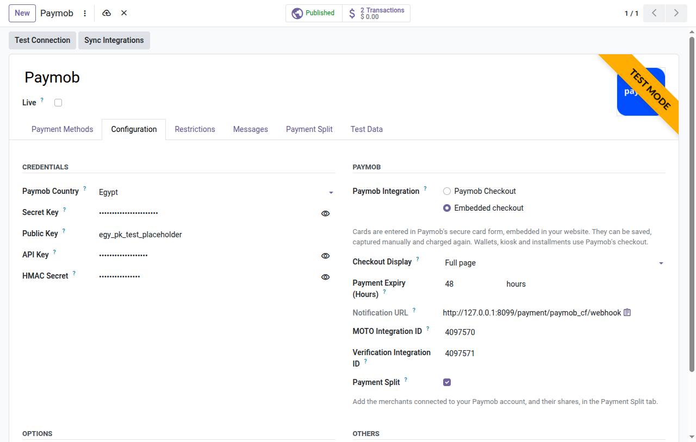
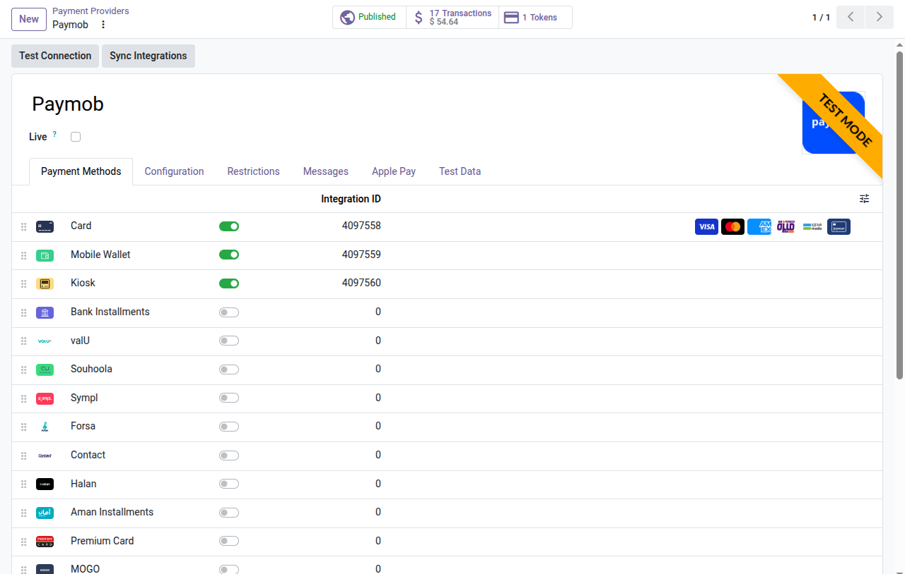
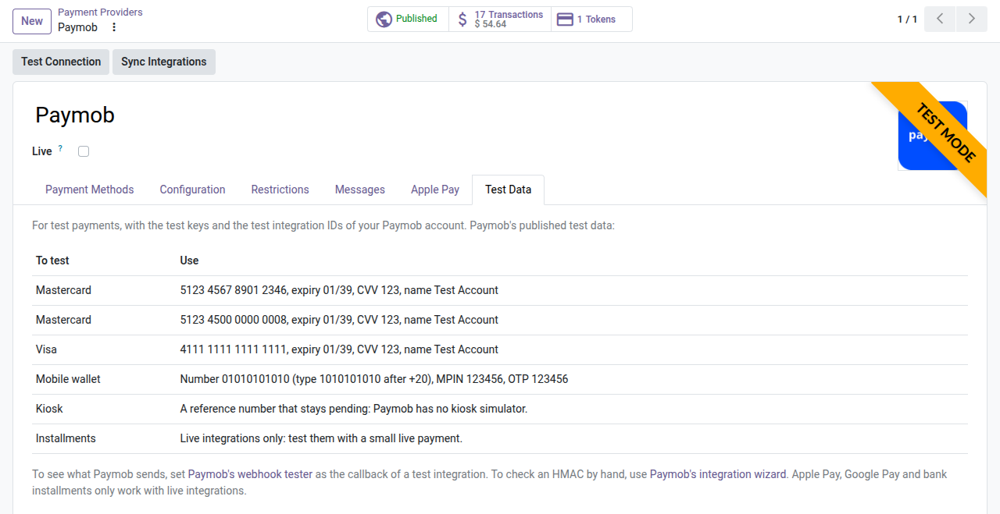
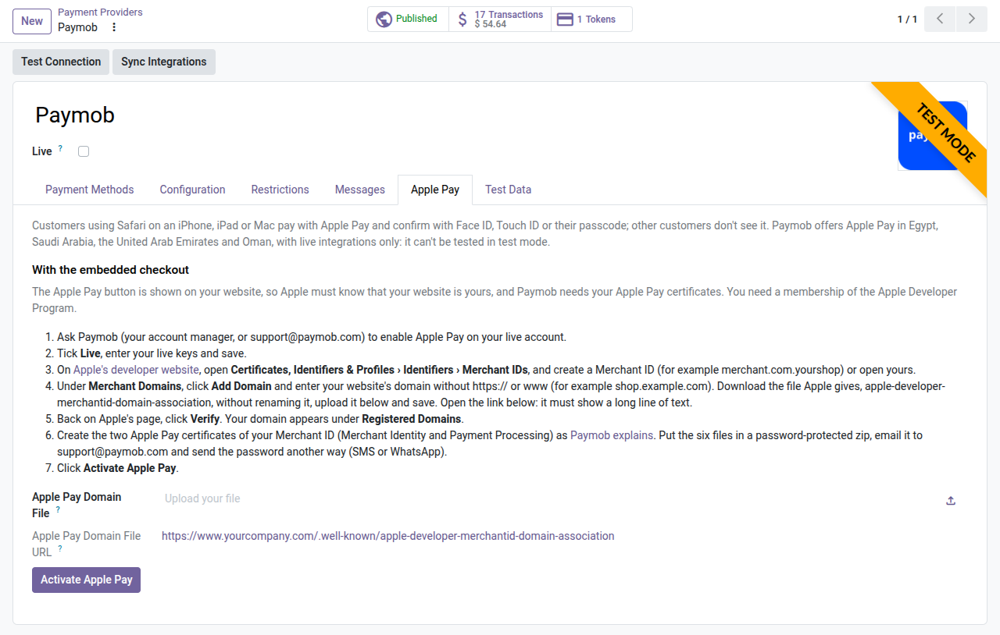
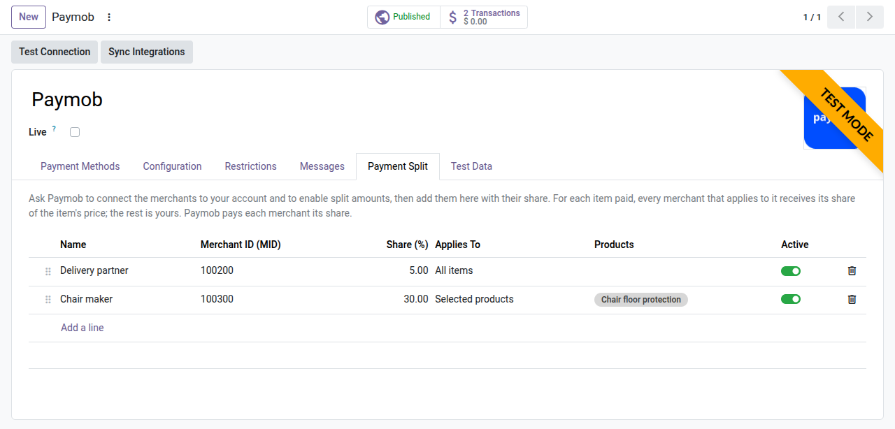

# Paymob Payments: administrator guide

How to set up and run the **Paymob Payments** module (`payment_paymob_cf`) on Odoo 20. For the daily tasks of
your team and what customers see, read the [user guide](user_guide.md).

## Contents

- [Before you start](#before-you-start)
- [1. Install the module](#1-install-the-module)
- [2. Enter your keys](#2-enter-your-keys)
- [3. Choose the integration and the display](#3-choose-the-integration-and-the-display)
- [4. Link your Paymob integrations](#4-link-your-paymob-integrations)
- [5. Notifications](#5-notifications)
- [6. Test](#6-test)
- [7. Go live](#7-go-live)
- [Apple Pay](#apple-pay)
- [Saved cards](#saved-cards)
- [Authorize, capture and void](#authorize-capture-and-void)
- [Payment split](#payment-split)
- [Settings reference](#settings-reference)
- [Accounting](#accounting)
- [Payment statuses](#payment-statuses)
- [Paymob response codes](#paymob-response-codes)
- [Security](#security)
- [Troubleshooting](#troubleshooting)

## Before you start

- A Paymob account in Egypt, Saudi Arabia, the UAE, Oman or Pakistan. Its dashboard has a test mode and a live
  mode, each with its own keys and integration IDs.
- Your Odoo website reachable from the internet over HTTPS, so that Paymob can bring customers back and send its
  notifications.
- Prices in the currency of your Paymob country (EGP, SAR, AED, OMR or PKR) on your website pricelist.
- The Invoicing app (installed with eCommerce) with a chart of accounts, for the Paymob journal.

This module is independent of Odoo's own basic Paymob connector (`payment_paymob`): both can be installed. Publish
the one your customers should use.

## 1. Install the module

In Apps, search for **Paymob Payments** and click **Activate**. The installation:

- adds the **Paymob** provider, in test mode and unpublished, set to your company's country when Paymob serves it;
- adds the payment methods and turns on Card, Mobile Wallet and Kiosk;
- creates the **Paymob** bank journal (in Arabic "مدفوعات باي موب") in each company, in the currency of its
  Paymob country, and sets it as the provider's payment journal;
- adds the scheduled action **Paymob: check pending payments**, which runs every 15 minutes.

## 2. Enter your keys

1. Open **Invoicing › Configuration › Payment Providers** (or Website › Configuration › Payment Providers) and
   click **Paymob**.
2. In the **Configuration** tab, choose the **Paymob Country** of your account.
3. In Paymob's dashboard, test mode, open **Settings › Developers › API Keys**. Copy the **Secret Key**, the
   **Public Key**, the **API Key** and the **HMAC Secret** (main user only) into Odoo. Leave **Live** unticked.
4. Click **Test Connection**. Odoo checks the API key and counts the integrations of your account in this mode.

## 3. Choose the integration and the display

| Setting | Choices |
|---|---|
| **Paymob Integration** | **Paymob Checkout**: every method is paid on Paymob's hosted checkout. **Embedded checkout**: cards (and Apple Pay, Google Pay) are entered in Paymob's card form, embedded in your payment page; wallets, kiosk and installments use Paymob Checkout. |
| **Checkout Display** | Full page, pop-up window or side panel, for Paymob Checkout. |
| **Payment Expiry (Hours)** | How long a payment, such as a kiosk reference, can be completed. 48 by default, up to 864 (36 days). |
| **Allow Saving Payment Methods** | Embedded checkout only: customers can save their cards. |

## 4. Link your Paymob integrations

Paymob gives each payment method of your account an **integration ID** (dashboard: **Settings › Payment
Integrations**, with the test/live toggle). Odoo tells Paymob which integration the customer pays with.

- Click **Sync Integrations**. Odoo lists your integrations in the provider's mode and fills the **Integration ID**
  of each payment method, by gateway type; card integrations of type Auth, MOTO or Verification fill the matching
  fields of the provider. Nothing is changed in your Paymob account. Methods without an integration are listed so
  you can ask Paymob to enable them.
- You can also type an ID on a payment method (open it from the **Payment Methods** tab).

The **Paymob** method (all methods) opens Paymob Checkout with every method that has an integration ID.

## 5. Notifications

Odoo sends its **Notification URL** (`https://<your website>/payment/paymob_cf/webhook`) with every payment:
Paymob notifies Odoo there when a payment changes, and when a card is saved. You can also set it as the
**Transaction processed callback** of each integration in Paymob's dashboard. Odoo checks each notification with
your HMAC secret and matches it with its payment by the order Paymob signs.

## 6. Test

While the provider is unpublished, its methods show on your website only to your own team, signed in with their
Odoo user. The provider's **Test Data** tab (test mode only) lists Paymob's published test data:

| To test | Use |
|---|---|
| Mastercard | 5123 4567 8901 2346 or 5123 4500 0000 0008, expiry 01/39, CVV 123, name Test Account |
| Visa | 4111 1111 1111 1111, expiry 01/39, CVV 123, name Test Account |
| Mobile wallet | Number 01010101010 (type 1010101010 after +20), MPIN 123456, OTP 123456 |
| Kiosk | A reference number that stays pending: Paymob has no kiosk simulator |
| Installments | Live integrations only: test them with a small live payment |

You can test on a computer that the internet can't reach: Paymob's notifications won't arrive, but Odoo asks Paymob
for the status when the customer comes back, while the customer waits, and every 15 minutes, and fetches the cards
customers saved.

To see what Paymob sends, set [Paymob's webhook tester](https://hooks.paymob.com) as the callback of a test
integration; to check an HMAC by hand, use [Paymob's integration wizard](https://wizard.paymob.com). Apple Pay,
Google Pay and bank installments only work with live integrations.

## 7. Go live

1. Tick **Live** (this also publishes the provider) and replace the four keys with the live ones, then save.
2. Click **Sync Integrations** again: live integrations have other IDs than test ones.
3. Click **Test Connection**.
4. Place one small real order and refund it from Odoo.

## Apple Pay

Customers using Safari on an iPhone, iPad or Mac pay with Apple Pay and confirm with Face ID, Touch ID or their
passcode. Other customers don't see it: the payment form leaves Apple Pay out on browsers and devices that can't use
it. Paymob offers Apple Pay in Egypt, Saudi Arabia, the United Arab Emirates and Oman (not in Pakistan), with **live
integrations only**: it can't be tested in test mode. Apple Pay payments can be refunded fully or partially.

The provider's **Apple Pay** tab repeats these steps, with the file upload and the **Activate Apple Pay** button.

### With Paymob Checkout

1. Ask Paymob (your account manager, or support@paymob.com) to enable Apple Pay on your live account.
2. Tick **Live**, enter your live keys and save.
3. In the **Apple Pay** tab, click **Activate Apple Pay**. Odoo finds the Apple Pay integration of your account,
   enters its ID on the Apple Pay payment method and turns the method on.

Paymob shows Apple Pay on its own secure checkout, so there is nothing to set up with Apple. Apple Pay always opens
Paymob Checkout in a full page, even when the **Checkout Display** is a pop-up or a side panel: browsers limit Apple
Pay inside frames.

### With the embedded checkout

The Apple Pay button is shown on your website, in Paymob's form. Apple must know that your website is yours, and
Paymob needs your Apple Pay certificates. You need a membership of the
[Apple Developer Program](https://developer.apple.com/programs/).

1. Ask Paymob to enable Apple Pay on your live account.
2. Tick **Live**, enter your live keys and save.
3. On [Apple's developer website](https://developer.apple.com/account/resources/identifiers/list/merchant), open
   **Certificates, Identifiers & Profiles › Identifiers › Merchant IDs**, and create a Merchant ID (for example
   `merchant.com.yourshop`) or open yours.
4. Under **Merchant Domains**, click **Add Domain** and enter your website's domain without `https://` or `www`
   (for example `shop.example.com`). Download the file Apple gives, `apple-developer-merchantid-domain-association`,
   without renaming it. In the **Apple Pay** tab, upload it in **Apple Pay Domain File** and save. Open the
   **Apple Pay Domain File URL** (`https://<your website>/.well-known/apple-developer-merchantid-domain-association`):
   it must show a long line of text. Odoo serves the file there, so you don't need access to the server.
5. Back on Apple's page, click **Verify**. Your domain appears under **Registered Domains**.
6. Create the two Apple Pay certificates of your Merchant ID, the **Merchant Identity** and the **Payment
   Processing** certificates, as
   [Paymob explains](https://developers.paymob.com/paymob-docs/need-help/setup-guides/apple-pay-setup/apple-pay-certificates-creation).
   Put the six files in a password-protected zip, email it to support@paymob.com and send the password another way
   (SMS or WhatsApp).
7. In the **Apple Pay** tab, click **Activate Apple Pay**.

**Activate Apple Pay** checks, in this order, the country of the provider, the live mode, the Apple Pay integration of
your account and, for the embedded checkout, the domain file, and tells you what is missing. It can't check Apple's
verification or the certificates: test with a small live payment from an iPhone, then refund it.

## Saved cards

With the **Embedded checkout** and **Allow Saving Payment Methods**:

- **While paying**, the customer ticks **Save my payment details**: Paymob saves the card with the payment and
  sends it to Odoo, which creates the saved card (brand, last four digits, expiry, name on the card).
- **Without paying**, from **My Account › Payment Methods**: needs the **Verification Integration ID**. Without it,
  Paymob isn't offered on that page.
- **Paying with a saved card**: Paymob Checkout opens with the saved card; the customer confirms it with its
  security code and the bank.
- **Charges while the customer is away** (e.g. subscriptions): need the **MOTO Integration ID**; Odoo charges the
  saved card through Paymob's server API.
- **Removing a card**: Paymob has no API to list or delete saved cards, so removing a card archives it in Odoo
  only; nothing can use it any more. Expired cards are archived when they would be shown to the customer.

## Authorize, capture and void

1. Ask Paymob for an **Auth** card integration and enter its ID in **Auth Integration ID**.
2. Tick **Capture Amount Manually**. Odoo requires every active payment method of the provider to support manual
   capture: turn off wallets, kiosk and installments on this provider, or keep them on a second Paymob provider.
3. Card payments then wait as **Authorized**. Capture them, fully or partially, or void them, from the order, the
   invoice or the transaction. Paymob voids authorizations that aren't captured within 14 days.

## Payment split

1. Ask Paymob to connect the merchants to your account and to enable split amounts. Paymob gives each one a
   merchant ID (MID).
2. Tick **Payment Split** on the provider, and add each merchant in the **Payment Split** tab: name, MID, share
   (%), and whether it applies to all items or to selected products.
3. With each payment, Odoo sends the share of each merchant (`split_amounts`): for every item it applies to, the
   merchant receives its share of the item's price; the rest is yours. Odoo refuses settings that would share out
   more than 100% of an item.

## Settings reference

| Setting | What it does |
|---|---|
| **Live** | Unticked: Paymob's test mode, no real money. Ticked: live payments. |
| **Paymob Country** | Egypt, Saudi Arabia, UAE, Oman or Pakistan: the Paymob platform and the currency of the provider. |
| **Secret Key, Public Key, API Key, HMAC Secret** | From Settings › Developers › API Keys, for the mode of the provider. Only administrators see the secret ones. |
| **Paymob Integration** | Paymob Checkout or Embedded checkout. |
| **Checkout Display** | Full page, pop-up window or side panel. |
| **Payment Expiry (Hours)** | How long a payment can be completed. |
| **Notification URL** | Read-only. Sent with every payment. |
| **Auth / MOTO / Verification Integration ID** | The card integrations for manual capture, charges while the customer is away, and saving a card without paying. |
| **Payment Split** | Shares each payment with the merchants of the Payment Split tab. |
| **Integration ID** (payment method) | The Paymob integration of the method. |
| **Test Connection**, **Sync Integrations** | Check the API key; fill the integration IDs. |
| **Test Data** tab | Test mode only: Paymob's published test data and tools. |
| **Apple Pay Domain File** (Apple Pay tab) | Embedded checkout: Apple's domain file, served at `/.well-known/apple-developer-merchantid-domain-association`. |
| **Activate Apple Pay** (Apple Pay tab) | Checks what Apple Pay needs and turns the Apple Pay method on. |
| **Payment Journal** | Where paid orders are posted. Paymob by default. |

**Several countries.** One provider serves one Paymob country. For accounts in several countries, duplicate the
provider, set the other country and its keys on the copy, click **Sync Integrations**, and give the copy a bank
journal in that country's currency.

## Accounting

Each company gets a **Paymob** bank journal (code PAYMB) in the currency of its Paymob country; the currency follows
the country while the journal has no entries. When Paymob confirms a payment, Odoo posts a customer payment in it
and reconciles it with the invoice. Its balance is the money Paymob collected and hasn't transferred yet: record
Paymob's settlements as internal transfers to your bank, and Paymob's fees as bank fees. A journal already using the
code PAYMB is reused; uninstalling keeps the journal and its entries.

## Payment statuses

| At Paymob | Transaction in Odoo |
|---|---|
| Pending (kiosk reference, bank OTP) | Pending; the kiosk reference is shown to the customer |
| Successful | Confirmed |
| Successful authorization | Authorized |
| Declined | Error, with the code explained |
| Voided | Canceled |
| Refunded | Confirmed; each refund is its own transaction |

Odoo learns the status from the customer's return (then asks Paymob), Paymob's signed notification, the waiting
page (which asks Paymob every few seconds), the scheduled action (every 15 minutes, pending payments of the last 10
days) and the **Check Paymob Status** button.

## Paymob response codes

Card declines carry the bank's response code (ISO 8583, e.g. 51 insufficient funds, 54 expired card); Paymob adds
its fraud checks (111 to 301) and the errors of its APIs. Each code is explained:

- the customer sees what to do when the problem is their card, bank or details, and a neutral message with the code
  otherwise;
- your team sees, in the transaction's **Paymob** tab, the code, what it means and what to check, with Paymob's
  message.

The full list is on the module's store page and in `const.py` (`ERROR_CODES`).

## Security

- No card numbers in Odoo: they are typed in Paymob's checkout or card form only.
- Every notification and return is checked against its HMAC-SHA512 signature; returns are confirmed by asking
  Paymob for the status.
- Payment pages are tied to the payment by a secret token.
- Only administrators see the secret key, the API key and the HMAC secret; keys and card tokens never appear in the
  logs.
- Neutralized copies of the database lose the Paymob keys.

## Troubleshooting

| Problem | What to check |
|---|---|
| The methods don't show at checkout | The provider is published and the methods are on; the website pricelist is in the provider's currency; the customer's country is one the method serves; the provider's Restrictions allow the order. |
| "error integration" or "error missing_integration" | The method has no integration ID, or one of the other mode: click **Sync Integrations** or type the ID. |
| Test Connection fails | The keys, without spaces, and their country and mode. |
| Paid at Paymob, but the order still waits | **Check Paymob Status**. If it happens often: HTTPS, the HMAC secret, and the scheduled action. |
| Apple Pay doesn't show at checkout | The customer uses Safari on an Apple device, over HTTPS; the Apple Pay method is on, with a live integration ID; the website's country and currency are among Paymob's Apple Pay countries. With the embedded checkout: the domain is verified at Apple and Paymob has your certificates. |
| Apple Pay: Apple can't verify the domain | Open the Apple Pay Domain File URL: it must show the file's text, not an error. Upload the file again without renaming it. If Odoo's Stripe connector is installed too, the Paymob file is served once it is uploaded. |
| Customers can't save cards | Embedded checkout, **Allow Saving Payment Methods**, customer signed in; a Verification integration to save without paying. |
| **Capture Amount Manually** is refused | The Auth Integration ID, and only methods that support manual capture on this provider. |
| A refund is refused | Odoo shows Paymob's reason and records nothing; kiosk payments can't be refunded through Paymob. |

Support: [info@codefish.com.eg](mailto:info@codefish.com.eg). Send your Odoo version, your Paymob country, the
integration you use and, for a payment issue, the transaction reference. Never send your keys by email.
