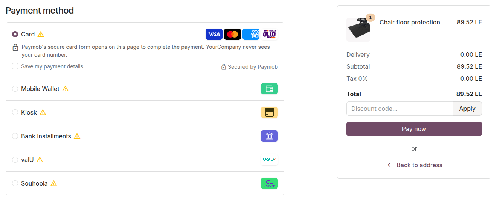
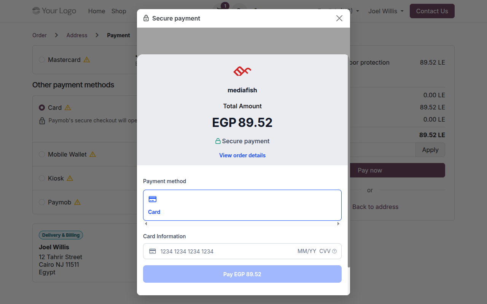
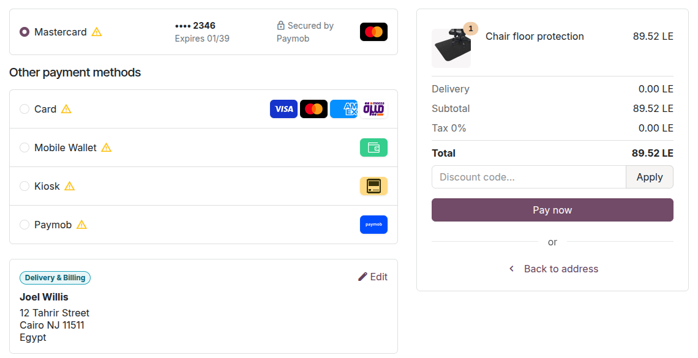
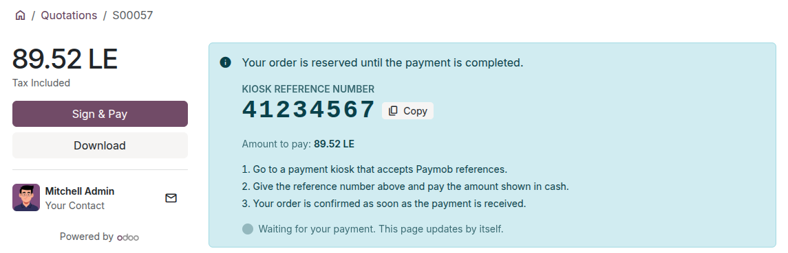
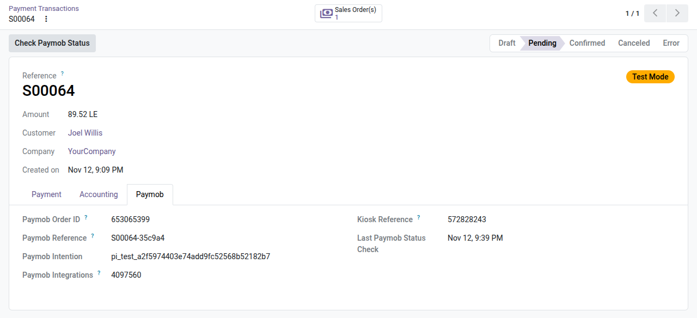
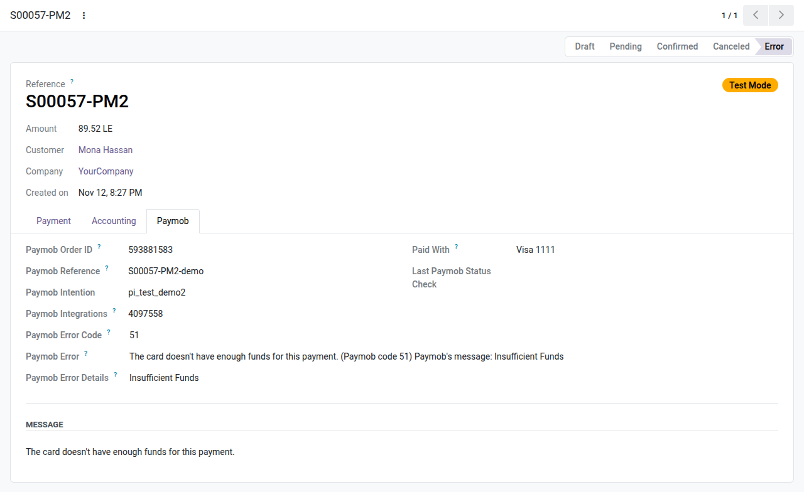

# Paymob Payments: user guide

For the people who work with Paymob payments every day (sales, accounting, customer service) and to know what
customers see. Setting the module up is in the [administrator guide](admin_guide.md).

## Contents

- [What customers see](#what-customers-see)
- [Find a payment](#find-a-payment)
- [Check a payment at Paymob](#check-a-payment-at-paymob)
- [Refund a payment](#refund-a-payment)
- [Capture or void a payment](#capture-or-void-a-payment)
- [Send a payment link](#send-a-payment-link)
- [Saved cards in the back office](#saved-cards-in-the-back-office)
- [Answering customers](#answering-customers)

## What customers see

The Paymob methods appear at the payment step of the shop, on invoices in the customer portal and on payment
links, each with its logo. Methods are offered to customers of the countries and currencies they serve.

### Card

1. The customer chooses **Card** and clicks **Pay now**.
2. Paymob's secure card form opens on the page (embedded checkout), or Paymob Checkout opens in a pop-up, a side
   panel or a full page. The card is typed there, never on your website.
3. The customer confirms the payment with their bank (3-D Secure), and comes back to the confirmation page.

In a pop-up or a side panel, the page follows the payment: once it is paid, the customer goes to the
confirmation page even if they close the window.

Signed-in customers can tick **Save my payment details** (embedded checkout) and pick the saved card next time; they
confirm it with its security code and their bank. They remove cards from **My Account › Payment Methods**.

### Apple Pay

Customers using Safari on an iPhone, iPad or Mac see **Apple Pay** (when your administrator has activated it), choose
it and confirm the payment with Face ID, Touch ID or their passcode, on Paymob's checkout or in Paymob's form on your
payment page. Other customers don't see it. Apple Pay payments are refunded like card payments, fully or partially.

### Kiosk (cash)

1. The customer chooses **Kiosk**; Paymob Checkout gives a reference number.
2. The confirmation page, and the order in the customer's portal, show the reference with a **Copy** button, the
   amount and the steps.
3. The customer pays the reference in cash at a payment kiosk. The page updates by itself once Paymob receives the
   payment, and the order is confirmed.

### Wallets and installments

With a mobile wallet, the customer enters the wallet number on Paymob Checkout and approves the payment on their
phone. With valU, Souhoola, Tabby, Tamara, bank installments and the other installment brands, the customer
chooses the plan on Paymob Checkout. The order is paid in Odoo as usual.

### In Arabic

When the customer browses your website in Arabic, the payment step, the hints and the messages are in Arabic, right
to left, and Paymob's card form follows.

## Find a payment

- From the sales order (**Payments** smart button), the invoice, or the provider (**Transactions**).
- Paid orders: Invoicing › Customers › Payments, journal **Paymob**.

The transaction's **Paymob** tab shows Paymob's order ID and reference, the integrations, the card or wallet paid
with, the kiosk reference, the installment plan and the last status check. When Paymob refused the payment, it
shows the code, what it means and what to check, with Paymob's message. Paymob's transaction ID is the
transaction's **Provider Reference**.

## Check a payment at Paymob

A customer says they paid, but the order still waits? Open the transaction and click **Check Paymob Status**; reload
the page after a few seconds. Odoo also checks every pending payment every 15 minutes.

## Refund a payment

1. Open the payment (Invoicing › Customers › Payments) and click **Refund**.
2. Keep the full amount or type a smaller one, then click **Refund**.
3. Odoo sends the refund to Paymob and records it. If Paymob refuses it, Odoo shows why and records nothing.

You can refund several times, up to the amount paid. Kiosk payments can't be refunded through Paymob; Tamara and
Premium Card only in full.

## Capture or void a payment

When your company captures card payments manually, they wait as **Authorized**. Click **Capture Transaction** (the
whole amount or a part) or **Void Transaction** on the order, the invoice or the transaction. Paymob voids
authorizations that aren't captured within 14 days.

## Send a payment link

Use **Generate a Payment Link** in the action menu of orders and invoices. The customer opens it and pays with any
Paymob method.

## Saved cards in the back office

The **Tokens** smart button of the Paymob provider lists the saved cards (last four digits only), with their expiry
date and the name on the card. Archiving a card removes it for the customer.

## Answering customers

| The customer says | What to do |
|---|---|
| "I paid but my order is still waiting." | Click **Check Paymob Status** on the transaction. |
| "I lost my kiosk reference." | It is on the order in their portal, and in the transaction's Paymob tab. |
| "My card was declined." | The transaction's Paymob tab explains the code. The customer can try another card or method. |
| "The payment failed with an error code." | Look the code up in the Paymob tab. If it is about your Paymob account, tell your administrator. |
| "Can I pay in installments?" | Yes, with the installment methods your Paymob account offers, or bank installments. |
| "How do I remove my card?" | **My Account › Payment Methods**, the bin next to the card. |
| "Can you take my card number by phone?" | No. Send a payment link instead. |
